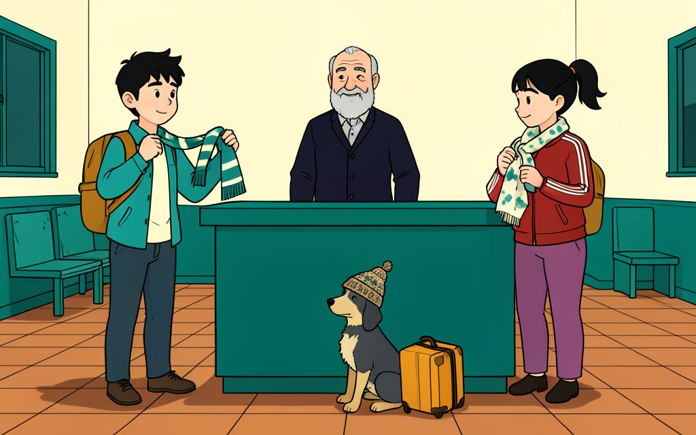
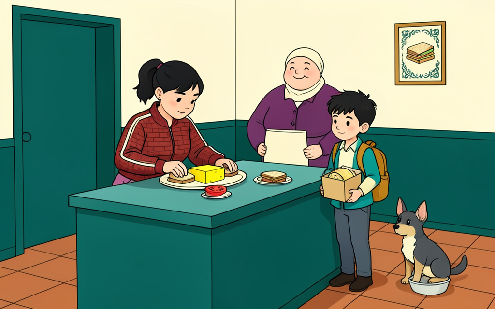
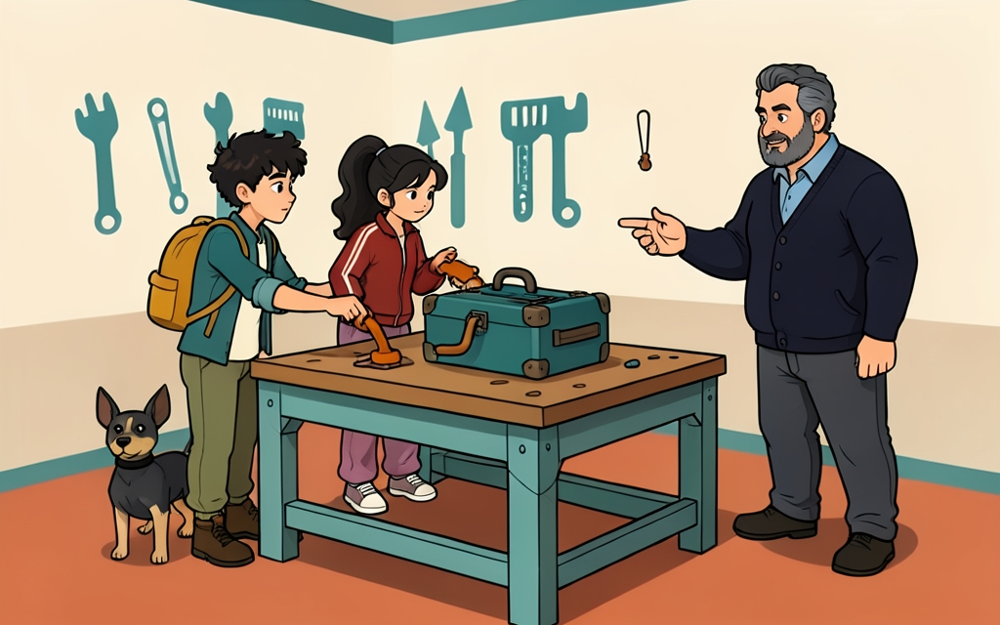
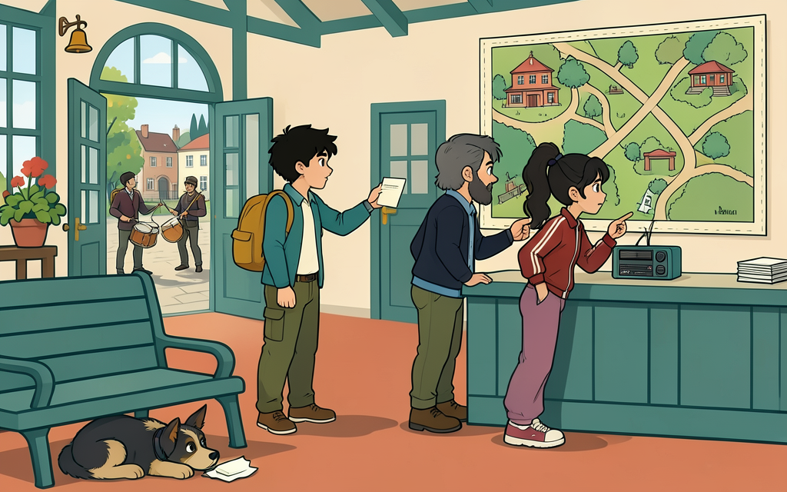
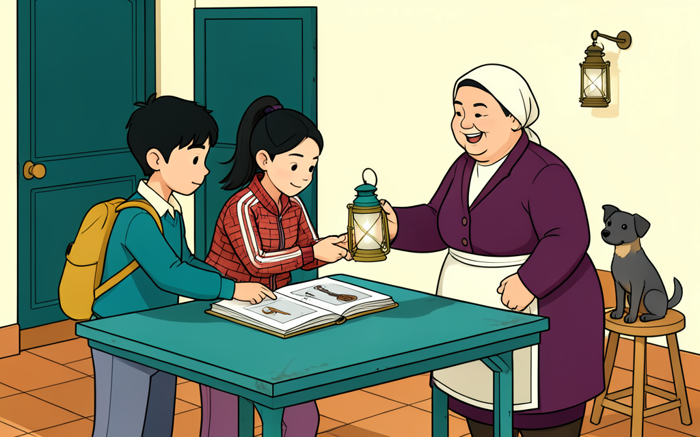

# מיני־משחקי אוצר מילים — Concept Art

28 בנובמבר 2026 · חמישה איורי תכנון וגלריית צפייה במשחק. **המיני־משחקים עצמם עדיין לא נבנו.**

## האיורים

- [מחלקת האבידות של פיצי — Lost & Found](lost-and-found.png): שני צעיפים, דלפק אבידות והאחים עם אבא ופיצי. [GDD](../../english-grade-7/vocabulary-games/lost-and-found.gdd.he.md).
- [המשמרת בבית הקפה — Café Shift](cafe-shift.png): הכנת כריכים, מרכיבים נפרדים ובעלת בית הקפה. [GDD](../../english-grade-7/vocabulary-games/cafe-shift.gdd.he.md).
- [הסדנה של אבא — Fix It, Dad!](fix-it-dad.png): מזוודת אביזרי במה ושולחן עבודה עם האחים ואבא. [GDD](../../english-grade-7/vocabulary-games/fix-it-dad.gdd.he.md).
- [רדיו התחנה — Message Relay](message-relay.png): פתק, רדיו ומפת הכפר; בחוץ נראים נגנים. [GDD](../../english-grade-7/vocabulary-games/message-relay.gdd.he.md).
- [מועדון המילים החשאיות — Word Detectives](word-detectives.png): מחברת רמזים ופנס אצל בעלת בית הקפה; פיצי על כיסא. [GDD](../../english-grade-7/vocabulary-games/word-detectives.gdd.he.md).

## התאמה לכיוון האמנותי

הבסיס הוא [כיוון האמנות של התחנה](../rural-station-art-direction.md) והאיורים הקיימים: עולם הרפתקה מצויר ושטוח, קווי מתאר חזקים, צורות צבע רחבות, קירות קרם, נגרות טורקיז דהויה ורצפת טרקוטה. נשמרו סימני זיהוי של האחים ופיצי: הילד עם תיק אוכרה ובגד טורקיז, הילדה בקוקו ובמעיל אדום, וכלב פחם־חום עם אוזניים זקופות. אלה דמויות הפרויקט, לא דמויות מהסדרות ששימשו רפרנס סגנוני.

האיורים נועדו לשפוט קומפוזיציה, יחסי דמויות ואווירה. הם אינם UI מצויר, ראיה ללמידה או נכסי אנימציה בשכבות. טקסט הגלריה הוא HTML בעברית ובאנגלית; לא מסתמכים על טקסט שנוצר בתוך תמונה.

## מקור ויצירה מקומית

- יצירת AI מקומית באמצעות MFLUX 0.24.0 ו־`black-forest-labs/FLUX.2-klein-4B`; אין שירות יצירה בזמן ריצת המשחק.
- snapshot: `e7b7dc27f91deacad38e78976d1f2b499d76a294`.
- גודל מקורות: 1024×640; ארבעה steps; quantization של 4 ביט; seeds נפרדים 281101–281105.
- [prompts.json](prompts.json) שומר את הפרומפטים, הרפרנס, ניסיונות התיקון והמסלול שנבחר לכל איור. שדה `pipeline` קובע מה שימש בקובץ הסופי; פרומפטי ניסיונות שנדחו אינם תיאור התוצאה הסופית.
- הסדנה והרדיו נוצרו בעריכת תמונת הרפרנס הקיימת `public/assets/station/station-hall.webp`. הסדנה עברה גם עריכת תיקון. המקור הראשוני של הסדנה היה קובץ ביניים מקומי; הוא אינו חלק מהמסירה.
- אבידות, בית הקפה והבלשים נוצרו מחדש באמצעות `mflux-generate-flux2` ו־`textGenerationOverrides`, לאחר שבעריכות הרפרנס הופיעו דמויות כפולות או פרטים לא ברורים. לא נדרשו נכסי צד שלישי חדשים או הורדת מודל חדש.
- חמשת קובצי ה־PNG כאן הם המקורות שנמסרו; נגזרות WebP באותו גודל נשמרו תחת `public/assets/vocabulary-concepts/`, עם Pillow, `quality=88` ו־`method=6`. אין תלות ב־Pillow להפעלת המשחק.
- המטא־דאטה ב־PNG שומר פרומפט ופרטי יצירה. סטטוס AI-generated אינו הצהרת זכויות בלעדיות או בדיקה משפטית של רישיון המודל.

## הגלריה שנמסרה

מסך הבית של התחנה → **גלריית קונספט ארט**.

- תמונה מרכזית ללא חיתוך, כותרת עברית/אנגלית, הסבר ודוגמאות מילים.
- בחירת כל אחד מחמשת האיורים, מעבר הקודם/הבא במעגל ופתיחה בגודל מלא בלשונית חדשה.
- כפתורי HTML עם פוקוס נראה, תיאור חלופי ו־`aria-pressed`; Enter/Space מפעילים כפתורים. Escape או ״חזרה לתחנה״ חוזרים ומחזירים פוקוס לכניסה.
- התמונה שנבחרה נשמרת רק כל עוד הגלריה פתוחה. אין שמירה, מדדי למידה, פעמונים או שינוי התקדמות כתוצאה מצפייה.
- תמונה שלא נטענה מציגה הודעה ומאפשרת בחירת איור אחר או יציאה.
- תצוגת שולחן מתוכננת ללא גלילה ב־1024×600, 1280×720 ו־1440×900; במסכים צרים מותרת גלילה וסידור בטור.

## מגבלות וביקורת לקראת הפקה

כל חמש התמונות נבדקו חזותית. נבחרו גרסאות עם סצנה קריאה, ללא כפילות של האחים או פיצי וללא כתוביות שנועדו לקריאה. ברדיו שני נגנים נוספים בחוץ הם חלק מהסצנה, לא כפילות של הדמויות הראשיות.

עדיין נדרשת עריכת אמן לפני שימוש כגירוי לימודי: בסדנה הידית נראית כבר מחוברת ולא מתקיים במדויק מצב ״לפני חיבור״; איור בית הקפה אינו מוכיח חצי מדויק או היעדר מרכיב בכל מנה; רמזי המחברת והמפה אינם סמנטיקה מאומתת. פרטים כאלה אינם משמשים כאן לבדיקת תשובות. גם וריאציות זהות בצבע עם תכונה מבדילה יחידה יצטרכו נכסים נפרדים במימוש.

לא נערך פלייטסט אנושי חדש. שאלות לביקורת: האם כל משחק מזוהה בלי הכיתוב? האם הפעולה המרכזית ברורה בגודל המסך הקטן? האם נשמרה זהות הדמויות בין האיורים? אילו פרטים צריך לפשט לפני פיצול לשכבות אינטראקטיביות?

## אימות

`tests/browser/concept-gallery.spec.ts` בודק פתיחה/חזרה ופוקוס, טעינת כל חמש התמונות, דפדוף וסגירה, היעדר שינוי בשמירה, שגיאת תמונה, ושלושת גדלי השולחן כולל חפיפות וחסימת כפתורים. בדיקת צילום מסך משלימה את בדיקות ה־DOM; התאמה לגבולות המסך לבדה אינה שוללת חפיפה בין אזורים.
