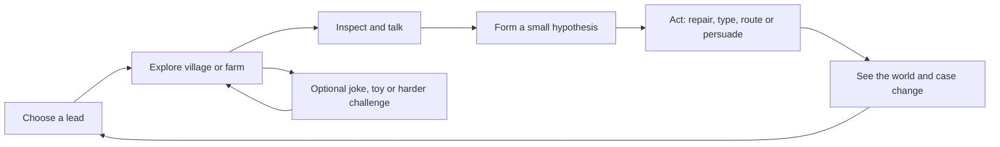

# Mechanics to investigate for Flock & Key

Research and design opinions, 13 November 2026. **64 candidate mechanics, informed by 43 games/series.** This is an exploration catalogue, not an implementation commitment or a replacement for the original GDD. No application behavior changed as part of this research.

The target is a **fun village-and-farm detective adventure about lost sheep**, with typing fluency and writing accuracy woven into meaningful actions. Gates is one possible activity within that adventure. The existing chapter about a nighttime farm celebration is a prototype side case; it is not automatically the solution to the final missing-sheep mystery.

## Read this first

My strongest recommendation is to combine **curiosity-led exploration, short evidence conversations, meaningful word actions and playful routing**. The player should want to find a sheep or test a theory; typing helps them do that. Walking, looking, listening and choosing need room to breathe. A village where every interaction demands another copied sentence risks becoming a worksheet with travel between questions.

For Gates, investigate **separated waves, visible intentions, different sheep roles and a planning/run mode** before simply increasing speed again. The present five rounds mostly vary gate count, flock size and timing on one route. More decisions could be more interesting than more pressure.

“Worth investigating” means the adaptation has a plausible fun hypothesis. It does **not** mean it improves learning, has been playtested here, or belongs in the final game. The source games were researched through developer/publisher pages, publisher-supplied Steam descriptions and official manuals, not newly played for this document. References support the original mechanic; the Flock & Key adaptations, priorities and warnings below are my design judgments. Mature mystery games are references for systems, not suggestions to import their subjects or tone.

### Navigation

- [Best first experiments](#best-first-experiments)
- [A. Gates, flock flow and planning: 01–10](#a-gates-flock-flow-and-planning)
- [B. Typing as an action: 11–18](#b-typing-as-an-action)
- [C. Spelling, correction and useful writing: 19–26](#c-spelling-correction-and-useful-writing)
- [D. Detective reasoning: 27–34](#d-detective-reasoning)
- [E. Conversations and character comedy: 35–42](#e-conversations-and-character-comedy)
- [F. Village and farm exploration: 43–50](#f-village-and-farm-exploration)
- [G. New mini-games and optional toys: 51–56](#g-new-mini-games-and-optional-toys)
- [H. Progression, replay and pacing: 57–64](#h-progression-replay-and-pacing)
- [A proposed adventure loop](#a-proposed-adventure-loop)
- [Prototype cards and fun tests](#prototype-cards-and-fun-tests)
- [Hebrew and learning design constraints](#hebrew-and-learning-design-constraints)
- [Source game index](#source-game-index)

### Entry labels

**Fit:** Gates; crates = guided sign painting; tracks = following Pitsi; post = spelling/mail reconstruction; chase = optional pace game; village; conversation; new = new mini-game. **Learning:** K = physical keys; T = typing/copying; S = independent spelling opportunity; E = editing/proofreading; R = reasoning/reading; X = expression/exploration. These are opportunities, not proven effects. Displaying an answer changes the evidence: T or supported recall must not be reported as independent S.

**Priority:** First = inexpensive or central hypothesis to prototype; Next = promising after the first tests; Later = expensive or speculative; Pass = investigate the lesson, probably omit the proposed form. Scope estimates are relative: small = isolated content/UI experiment; medium = new reusable interaction; large = new simulation, authoring system or substantial content. They are not time estimates.

## Best first experiments

| Mechanic IDs | Experiment | Where | Why I would start here | Scope |
| --- | --- | --- | --- | --- |
| 01, 03 | Two separated sheep waves with readable arrivals | Gates | Changes the timing problem instead of only asking for faster fingers | Small–medium |
| 02, 10 | Prepare, run, undo one action | Gates | Tests whether this toy wants to be a planning puzzle, an action game, or offer both | Medium |
| 27, 28, 35 | Inspect a clue, ask a witness, write one conclusion | Village/conversation | A tiny version of the actual detective adventure | Medium |
| 19, 20, 21 | Compare two letters and repair one meaningful discrepancy | Post or new desk game | Gives correction an observable purpose | Small–medium |
| 11, 12 | Choose which useful action to type first | Chase or new rescue scene | Adds agency to typing rather than another fixed word list | Medium |
| 32, 36 | Search a tiny local archive or ask about a discovered topic | Conversation/post office | Makes words tools for investigation | Medium |
| 43, 44, 49 | Two leads in a small walkable hub, each changing the village | Main game | Tests whether exploration itself is appealing | Large for the first hub; smaller thereafter |
| 04, 48 | Give sheep distinct personalities and useful roles | Gates/main game | Makes finding a particular sheep emotionally meaningful | Medium–large |
| 51, 52 | Organize parcels or repair the gearbox | New mini-game | Two different forms of satisfying hands-on activity | Medium |
| 13, 53 | Let an optional silly interaction actually do something | World/conversation | A cheap test of playfulness outside assessment | Small |

Build **one** experiment at a time. These rows are alternatives and dependencies, not a request to build ten systems together.

## A. Gates, flock flow and planning

### 01. Show intentions before asking for a reaction

**Fit:** Gates, chase. **Learning:** K/T. **Priority:** First. **Scope:** Small.

**Reference:** [Into the Breach](https://store.steampowered.com/app/590380/) makes upcoming enemy attacks visible; [Mini Motorways](https://dinopoloclub.com/games/mini-motorways/) centers readable traffic flow.

**Adaptation:** Show which sheep group is approaching which gate, with a route arrow and an arrival cue. Retain an optional simple next-key hint, but let the player read the situation themselves.

**My take:** Anticipation can turn “press the glowing key” into a decision. Too many arrows will turn the farm into an airport display. Try one approaching group and two possible gates; keep it only if the player can explain what they anticipated without needing the hint to answer for them.

### 02. Prepare the route, then watch it run

**Fit:** Gates, new route puzzle. **Learning:** K/R; optional T. **Priority:** First. **Scope:** Medium.

**Reference:** [Railbound](https://store.steampowered.com/app/1967510/) builds and reroutes connections for moving carriages; [Tin Hearts](https://store.steampowered.com/app/1831700/) guides autonomous walkers through contraptions.

**Adaptation:** A calm planning mode lets the player set two gate states or a short instruction sequence, then release the flock. Provide a live mode for players who prefer reacting.

**My take:** Watching your plan work is a different pleasure from typing quickly. It could make Gates a stronger puzzle, but should not replace its physical-key practice unnoticed. Prototype a single junction; ask whether planning or operating was more enjoyable.

### 03. Separated waves instead of one longer convoy

**Fit:** Gates. **Learning:** K, later T. **Priority:** First. **Scope:** Small–medium.

**Reference:** [Overcooked! 2](https://store.steampowered.com/app/728880/) structures action around incoming jobs; traffic management in [Mini Motorways](https://dinopoloclub.com/games/mini-motorways/) changes as demand grows. Applying discrete waves to sheep is our proposal.

**Adaptation:** Two clearly announced groups leave with a meaningful gap. A gate may close between groups, creating a second decision rather than simply trailing more sheep through one opening.

**My take:** This is my strongest next Gates experiment. A gap that only forces idle waiting is worse than the current convoy. During the gap, show another useful job or let the player release the next group. Vary gap and overlap independently.

### 04. Sheep with different jobs, not just different speeds

**Fit:** Gates, village, new escort puzzles. **Learning:** K/R, optional T/S names. **Priority:** Next. **Scope:** Medium–large.

**Reference:** [Tinykin](https://store.steampowered.com/app/1599020/) gives groups distinct powers used to solve environmental problems.

**Adaptation:** One sheep follows a bell, another carries a ribbon that reveals where it has been, another can reach a low opening. Show roles through shape, behavior and symbols, not color alone.

**My take:** Roles can make lost sheep memorable characters and enable new puzzles. Randomly disobedient sheep would make rules feel unreliable. Start with two predictable roles and one choice; keep the role only if players use it intentionally.

### 05. Route to a destination, not merely through every gate

**Fit:** Gates, new village transport game. **Learning:** K/R, optional T/S destination names. **Priority:** Next. **Scope:** Large.

**Reference:** [Mini Metro](https://dinopoloclub.com/games/mini-metro/) connects destinations with a transport network; [Railbound](https://store.steampowered.com/app/1967510/) uses connections and switches.

**Adaptation:** A small fork sends sheep to the meadow or home. The task is to get a named sheep to the appropriate place, using a legible sign or witnessed clue.

**My take:** A real route choice would add more than a sixth timer variant. It also changes today's simulation substantially: sheep would need authored branches and valid destinations. Test one fork before designing a network. Wrong turns should loop safely back, not lose sheep.

### 06. One scarce tool creates a scheduling choice

**Fit:** Gates, gearbox puzzle. **Learning:** K/R. **Priority:** Next. **Scope:** Small–medium.

**Reference:** [Mini Motorways](https://dinopoloclub.com/games/mini-motorways/) asks where to use limited upgrades; [Touch Type Tale](https://store.steampowered.com/app/909470/) makes typed commands serve tactical decisions.

**Adaptation:** Keep one shared gearbox but make two genuinely useful requests compete for it. An optional future mode might let the player choose a quick short opening or a slower long opening.

**My take:** Scarcity is interesting only when both alternatives matter. A busy light plus discarded input is otherwise just lag. Show the reservation and when the tool becomes available. Test whether players describe a choice, rather than report that their key did not work.

### 07. Hold, release and merge groups

**Fit:** Gates. **Learning:** K/R. **Priority:** Next. **Scope:** Medium–large.

**Reference:** [Railbound](https://store.steampowered.com/app/1967510/) uses barriers to delay carriages and switches to redirect them.

**Adaptation:** Use a waiting pen to let one group cross before releasing another. Make grouping the puzzle: “Can these three travel together?” Crossings must have explicit safe occupancy rules.

**My take:** This could create satisfying “now!” moments without faster typing. Avoid a situation where one early mistake permanently jams the farm. Prototype two groups, one merge and a reset/undo; no extra gate types initially.

### 08. Programmable helpers and short command sequences

**Fit:** New farm-machine game; later Gates. **Learning:** K/T/R. **Priority:** Later. **Scope:** Medium–large.

**Reference:** [Human Resource Machine](https://store.steampowered.com/app/375820/) programs workers to solve tasks.

**Adaptation:** Give Pitsi three visible commands such as go, wait, ring. Assemble a tiny plan, test it, then edit one instruction. A typed version can use short authored Hebrew verbs.

**My take:** The dog executing a silly plan could be delightful. A programming curriculum could also overwhelm the typing game. Limit the first test to three commands, no loops. Plan editing is reasoning; copying the command labels does not demonstrate independent spelling.

### 09. Optional efficiency targets after basic success

**Fit:** Gates, new transport/repair games. **Learning:** K/T/R depending on input. **Priority:** Next; partly present. **Scope:** Small.

**Reference:** [Good Job!](https://www.nintendo.com/us/store/products/good-job-switch/) allows completion amid mishaps and replay for better results.

**Adaptation:** After bringing everyone home, offer one optional goal: fewer unnecessary gate actions, a smoother convoy, or less waiting. Choose the target; do not demand all three simultaneously.

**My take:** This can give a satisfying replay purpose without threatening story progress. A medal determined mostly by unseen formulas is less interesting. The current medal system is a starting point; test a visible “keep this group together” goal against abstract score chasing.

### 10. Undo or rewind a short mistake

**Fit:** Gates planning mode, new contraption game. **Learning:** R/K; preserve raw learning events. **Priority:** First. **Scope:** Medium.

**Reference:** [Tin Hearts](https://store.steampowered.com/app/1831700/) explicitly supports pause, fast-forward and rewind.

**Adaptation:** Rewind the world to just before the last gate command, or undo one planning instruction. Keep the original input record if the activity measures typing; world undo must not erase evidence of an insertion error.

**My take:** Cheap experimentation is valuable when players are predicting motion. Unlimited rewinding may flatten a live timing challenge, so compare one-action undo with instant retry. Keep it if the player tries a new idea after using it.

## B. Typing as an action

### 11. Words perform useful world actions

**Fit:** Village, chase, new tool/rescue game. **Learning:** T or S, depending on prompts. **Priority:** First. **Scope:** Medium.

**Reference:** [Epistory](https://store.steampowered.com/app/398850/) uses keyboard interaction throughout its adventure; [Cryptmaster](https://store.steampowered.com/app/1885110/) uses words for interaction and abilities.

**Adaptation:** Type an authored action to ring a bell, repair a label or call Pitsi. Give the word a visible consequence rather than making every correct answer fill the same progress bar.

**My take:** This gives typing a reason to exist. Typing a verb for every door opening will become a tax. Test three distinct effects in a short scene, and keep ordinary walking and inspection easy. Never require a hidden exact synonym without a way to discover or choose it.

### 12. Choose which word deserves attention first

**Fit:** Chase, new sheep rescue; later Gates with word commands. **Learning:** T; S only in clearly separate recall tasks. **Priority:** First. **Scope:** Medium.

**Reference:** [Touch Type Tale](https://store.steampowered.com/app/909470/) connects typing to tactical tasks; [Epistory](https://store.steampowered.com/app/398850/) includes typed action encounters.

**Adaptation:** Two useful actions are available: clear the path or call a sheep back. The player chooses one, types its word, sees the effect, then handles the other. Begin with two targets and generous timing.

**My take:** Selection adds agency that a fixed list lacks. The shortest word must not always be the dominant strategy. Time spent deciding is not finger-speed evidence. Test whether the player has an understandable reason for choosing the first target.

### 13. A harmless word playground

**Fit:** Village, conversation, optional mini-game. **Learning:** X/T; sometimes S. **Priority:** First. **Scope:** Small for a bounded toy.

**Reference:** [Cryptmaster](https://store.steampowered.com/app/1885110/) emphasizes playful word interaction; [Scribblenauts Unlimited](https://store.steampowered.com/app/218680/) makes created objects part of play.

**Adaptation:** At a tinker's bench, a small known vocabulary produces amusing effects: a hat lands on a scarecrow, a bell starts an argument between sheep. Offer click choices too. Effects are local, authored and reversible.

**My take:** We need reasons to use the keyboard that are not assessment. Do not promise “type anything” with six supported words. Clearly frame the toy and respond kindly to unsupported input. Look for voluntary experiments, not a completion count.

### 14. Repair a word to repair the world

**Fit:** Crates, post, village signs; new word-workshop game. **Learning:** E, sometimes S. **Priority:** First. **Scope:** Medium.

**Reference:** [Typoman](https://store.steampowered.com/app/336240/) creates, changes and destroys words to affect the environment.

**Adaptation:** A damaged label changes the function or meaning of an object. Restore the missing or incorrect letter, then watch the windmill, bridge sign or gearbox behave correctly.

**My take:** This is a strong marriage of correction and consequence. English visual puns do not automatically work in Hebrew. Author a few Hebrew examples first, with a human language review, before building a general system. The puzzle should require noticing an edit, not retyping a paragraph.

### 15. Summon one of several valid solutions

**Fit:** New tool bag, village obstacles. **Learning:** S/X if unexposed; supported T otherwise. **Priority:** Next. **Scope:** Large beyond a tiny vocabulary.

**Reference:** [Scribblenauts Unlimited](https://store.steampowered.com/app/218680/) solves situations through summoned objects and their properties.

**Adaptation:** Reach a hanging clue with a ladder, rope or helper. Support an explicit authored set of plausible objects, each with a distinct short animation.

**My take:** Multiple solutions make the player feel inventive. A fake open-ended system that rejects sensible answers feels unfair. Start with one obstacle and three solutions; use deterministic local content, not runtime AI. If most attempts hit unsupported words, narrow the promise or stop.

### 16. Properties change how an object works

**Fit:** New workshop puzzle; later village. **Learning:** E/S/R. **Priority:** Later. **Scope:** Large.

**Reference:** Object properties are central to [Scribblenauts Unlimited](https://store.steampowered.com/app/218680/).

**Adaptation:** Choose or write a relevant property for a tool: a longer rope reaches a clue; a quieter bell avoids startling a timid sheep. Introduce one property and one visible consequence at a time.

**My take:** This supports experimentation better than arbitrary adjective drills. Hebrew agreement, inflection and natural phrasing add substantial content work. First test with selectable labels; only add independent writing if it improves the activity rather than adding ambiguity.

### 17. Edit the rules of a tiny puzzle

**Fit:** New magical-sign or workshop mini-game. **Learning:** R/E, optional T. **Priority:** Later. **Scope:** Large.

**Reference:** [Baba Is You](https://store.steampowered.com/app/736260/) exposes rules as manipulable word blocks.

**Adaptation:** Move or edit one rule such as which object opens a gate. Show the complete rule and its effects; do not introduce a full language or unrestricted logic system.

**My take:** Surprising rule changes can create excellent discoveries. They can also shift the game toward abstract programming and away from the sheep mystery. Prototype one rule swap on paper. Reject a design whose challenge is deciphering grammar rather than solving a visible situation.

### 18. Learn a small vocabulary of powers through examples

**Fit:** New word-magic game, village tool discoveries. **Learning:** R/T; S in later supported or independent contexts. **Priority:** Next. **Scope:** Medium.

**Reference:** [LOK Digital](https://store.steampowered.com/app/2207440/) gives discovered words different world-changing effects.

**Adaptation:** Teach a few useful Hebrew action words through demonstration. Recombine those known actions in later scenes instead of adding longer words indefinitely.

**My take:** The pleasure is “I know what this does; I can use it here.” Avoid teaching a fictional language when the goal is Hebrew. Test whether a player transfers the known action to a new situation without an instruction overlay.

## C. Spelling, correction and useful writing

### 19. A discrepancy desk

**Fit:** Post, new village records mini-game. **Learning:** E/R. **Priority:** First. **Scope:** Small–medium.

**Reference:** [Papers, Please](https://store.steampowered.com/app/239030/) makes document inspection the central task. Our child-facing adaptation concerns parcel and farm records.

**Adaptation:** Compare a parcel label with a delivery note. Identify which field disagrees, then correct it. Begin with one relevant difference, not a crowded desk of tiny documents.

**My take:** “Find what does not fit” is more investigative than typing a dictated list. Keep the original's document interaction, not its punitive bureaucracy. A visible reference makes this editing/comparison, not independent spelling. Test one parcel before adding a service queue.

### 20. A correctly spelled word can still be the wrong word

**Fit:** Post, conversations, suspect notes. **Learning:** E/R; optional S. **Priority:** First. **Scope:** Small.

**Reference:** [Typoman](https://store.steampowered.com/app/336240/) links written words to world meaning; document interpretation in [Papers, Please](https://store.steampowered.com/app/239030/) motivates checking context.

**Adaptation:** A deliberately authored note requests חלב (milk) where the task needs חבל (rope). Decide which meaning fits the evidence, then repair the transposed letters. Both are real Hebrew words.

**My take:** This can make proofreading feel like solving the case. Do not turn the child's accidental mistake into a public joke. Put the comic misunderstanding in an NPC-authored note; respond neutrally to the player's corrections. Test whether context, rather than a hidden answer rule, makes the intended word clear.

### 21. Minimal repairs instead of full re-entry

**Fit:** Crates, post, conversation notes. **Learning:** E. **Priority:** First. **Scope:** Small–medium.

**Reference:** Word alteration in [Typoman](https://store.steampowered.com/app/336240/) and physical repair in [Assemble with Care](https://store.steampowered.com/app/1202900/) suggest a repair-first interaction.

**Adaptation:** Fix the one broken part of a label using normal cursor movement, selection and Backspace. The completed repair reveals a clue or restores a useful sign.

**My take:** Repairing can be more satisfying than erasing everything and starting again. Forced “only one edit allowed” rules would punish exploration. Compare free editing with a guided one-letter repair, preserving the real input history and composition behavior.

### 22. Identify something using a field guide

**Fit:** Village, tracks, new seed/plant identification game. **Learning:** R/E/T; S only without the reference. **Priority:** Next. **Scope:** Medium.

**Reference:** [Strange Horticulture](https://store.steampowered.com/app/1574580/) identifies plants using clues and an encyclopedia.

**Adaptation:** Compare a burr caught in wool with two or three illustrated plants. Identify where the sheep probably walked, then label the sample in the notebook.

**My take:** This naturally joins reading, observation and investigation. A field guide copied verbatim is not a spelling test, and need not be one. Start with clear features; if players mostly scan dense text or try every name, simplify the evidence.

### 23. Restore a message, then use what it says

**Fit:** Existing post game, main mystery. **Learning:** S with audio/context; E/T when revealed. **Priority:** First. **Scope:** Small–medium.

**Reference:** Language interpretation drives consequences in [Heaven's Vault](https://www.inklestudios.com/heavensvault/); [Chants of Sennaar](https://store.steampowered.com/app/1931770/) connects deciphering to communication.

**Adaptation:** Restore a few damaged words in a note. The repaired message offers two plausible next leads; inspect the map or ask a witness to decide where to go.

**My take:** Writing should unlock meaning, not just a victory jingle. Avoid a mystery that can be solved by filling words without reading the note. Test whether the player uses the restored information in their next decision.

### 24. Make a useful record for someone else

**Fit:** Conversation, village errands, post. **Learning:** S/T/X depending on support. **Priority:** Next. **Scope:** Medium.

**Reference:** Repairing others' possessions matters to the townspeople in [Assemble with Care](https://store.steampowered.com/app/1202900/); helping characters is part of [A Short Hike](https://store.steampowered.com/app/1055540/).

**Adaptation:** Write a short missing-sheep notice or delivery label that an NPC visibly uses later. Offer a phrase template, optional word help and a way to choose instead of type.

**My take:** A social consequence can make writing feel useful. Mandatory long form filling is a danger. Begin with one name and one distinctive feature. Separate authored-answer spelling tasks from creative captions whose wording we cannot fairly auto-grade.

### 25. Sort by meaning, then retrieve by writing

**Fit:** Crates, post, new storeroom game. **Learning:** R/T; later S. **Priority:** Next. **Scope:** Medium.

**Reference:** [Wilmot's Warehouse](https://store.steampowered.com/app/839870/) makes organization and quick retrieval the activity.

**Adaptation:** Organize farm tools however you like, then fulfill a few requests by finding and naming them. Labels can be shown in the first round and optional later.

**My take:** Personal organization is a more interesting choice than dropping every word into a fixed category. Memory and search time will influence performance, so do not report the whole round as typing speed. Test whether players invent and enjoy their own arrangement.

### 26. Revisit vocabulary through a new need

**Fit:** Across village, post, crates and chase. **Learning:** Potential S; exposure tracked. **Priority:** Next. **Scope:** Medium content work.

**Reference:** Known symbols become useful across contexts in [Chants of Sennaar](https://store.steampowered.com/app/1931770/); recurring world actions in [Epistory](https://store.steampowered.com/app/398850/) suggest reuse rather than isolated lists.

**Adaptation:** A tool named while repairing the mill is needed later in a message or witness account. Change the situation; do not repeat the same exercise with a new background.

**My take:** Coherent reuse could feel like understanding the village. It is a learning hypothesis, not proof of retention. Track recent exposure, provide help, and compare enjoyment with a conspicuous “review these words again” screen.

## D. Detective reasoning

### 27. A notebook that holds evidence, not just trophies

**Fit:** Main game, conversations, tracks. **Learning:** R/X; optional T. **Priority:** First. **Scope:** Medium.

**Reference:** [Chants of Sennaar](https://store.steampowered.com/app/1931770/) uses a notebook to track interpreted symbols; [Duck Detective](https://store.steampowered.com/app/2637990/) ties evidence to deductions.

**Adaptation:** Record what was seen, who said it and where it came from. Keep observed facts separate from the player's current explanation. Let the player pin a useful clue for a conversation.

**My take:** This can make the player feel like a detective and reduce memory burden. An oversized card board can become a second inventory chore. Start with three clues, one open question and a direct jump back to the relevant scene.

### 28. Build a short explanation from evidence

**Fit:** Main mystery, conversation conclusions. **Learning:** R/T/E; S only under separate conditions. **Priority:** First. **Scope:** Medium.

**Reference:** [Duck Detective](https://store.steampowered.com/app/2637990/) fills deduction blanks; [The Case of the Golden Idol](https://store.steampowered.com/app/1677770/) reconstructs events from clues.

**Adaptation:** Complete one statement: who went where, and why. Offer evidence cards for reasoning and optional typed key words for practice. Confirm the reasoning separately from spelling.

**My take:** Probably the strongest bridge between the village story and educational input. Do not make the player repeatedly type a correct theory because of one spelling error. Test whether they can explain the inference without reading a prewritten sentence back to us.

### 29. Point out a contradiction kindly

**Fit:** Conversations, post records. **Learning:** R/E. **Priority:** First. **Scope:** Medium.

**Reference:** [Ace Attorney's official crossover manual](https://www.nintendo.com/eu/media/downloads/games_8/emanuals/nintendo_3ds_2/professor_layton_vs__pheonix_wright__ace_attorney/ElectronicManual_Nintendo3DS_ProfessorLaytonVsPheonixWrightAceAttorney_EN.pdf) describes pressing witnesses and presenting contradictory evidence.

**Adaptation:** A villager says no one used the gate, but a ribbon is caught in its hinge. Present the ribbon and ask what might explain it. Misremembering is a valid story explanation; everyone need not be a liar.

**My take:** This gives conversation a real action. Avoid hostile cross-examination and arbitrary “present exactly this item on exactly this line.” Begin with two statements and one relevant clue; allow a gentle clarification if the pairing is wrong.

### 30. Identify a sheep from several small observations

**Fit:** Main game, new sheep-identification puzzle. **Learning:** R/T; optional S names. **Priority:** Next. **Scope:** Medium.

**Reference:** [Return of the Obra Dinn](https://store.steampowered.com/app/653530/) is an investigation built around observation and deduction. Combining costume, location and witness details for sheep is our adaptation.

**Adaptation:** A silhouette, bell sound and partial description distinguish two possible sheep. A visible comparison view prevents the puzzle from depending on remembering a tiny off-screen detail.

**My take:** This supports the idea that each sheep is a character. Make features redundant and readable, with an audio alternative; do not rely on color alone. Test with two sheep before creating a large roster.

### 31. Reconstruct what happened before and after

**Fit:** Main mystery, post, new timeline game. **Learning:** R/E. **Priority:** Next. **Scope:** Medium.

**Reference:** [The Case of the Golden Idol](https://store.steampowered.com/app/1677770/) reconstructs scenes and a connected story; [Her Story](https://store.steampowered.com/app/368370/) explores non-linear records.

**Adaptation:** Put three illustrated events in order: the bell rang, the gate opened, the baker saw wool. Let one short corrected time or location field resolve the uncertainty.

**My take:** A timeline can produce a good “now I see!” moment. Many nearly identical text cards will feel like a reading test. Begin with distinct visual events and one meaningful ambiguity.

### 32. Search a local archive with a word

**Fit:** Post office, conversations, village records. **Learning:** S/R or supported T. **Priority:** First. **Scope:** Medium.

**Reference:** [Her Story](https://store.steampowered.com/app/368370/) lets the player search a recorded interview database.

**Adaptation:** Search six authored witness notes or delivery records for a discovered term such as פעמון. A hit reveals a new account; suggested topics remain available if spelling is difficult.

**My take:** This makes typing an investigative tool. Hidden exact-keyword guessing is a major risk. Support authored synonyms and visible discovered topics; distinguish “no relevant record” from “try correcting this spelling.” Use local content, not a remote search service.

### 33. Learn something that makes an old place newly useful

**Fit:** Main village mystery. **Learning:** R/X; optional later S. **Priority:** Next. **Scope:** Medium–large.

**Reference:** [Outer Wilds](https://store.steampowered.com/app/753640/) makes exploration and uncovering mysteries central; [Heaven's Vault](https://www.inklestudios.com/heavensvault/) connects interpretation to narrative discoveries.

**Adaptation:** A witness explains that a sheep follows a certain bell. The player returns to the already accessible bell tower and tries it. The new “key” is understanding, not a purchased item.

**My take:** This can make the world feel connected. Do not force a long return walk or withhold an interaction merely because an invisible quest flag is missing. Test whether the clue suggests the action naturally; allow an early correct experiment to work.

### 34. A free hint ladder that preserves discovery

**Fit:** All puzzles, conversations, Gates. **Learning:** Support classification varies. **Priority:** First; extend existing help. **Scope:** Small–medium.

**Reference:** [Professor Layton's Nintendo introduction](https://www.nintendo.com/en-gb/News/2011/The-Beginners-Guide-to-the-Professor-Layton-Games-253601.html) describes smaller puzzles inside a mystery and hint purchases. We borrow graduated assistance and explicitly discard its coin cost.

**Adaptation:** First point to the relevant place, then explain the relationship, then offer the action or answer. Show which kind of help was used without scolding.

**My take:** “Look at the hinge” can preserve the satisfying conclusion better than instantly revealing it. Do not make the player fail several times to unlock help. Ask which hint restored curiosity rather than simply measuring how many they used.

## E. Conversations and character comedy

### 35. Show a clue to ask a better question

**Fit:** Conversations, main mystery. **Learning:** R; optional short T/S topic. **Priority:** First. **Scope:** Medium.

**Reference:** Evidence presentation and questioning in [Ace Attorney's official crossover manual](https://www.nintendo.com/eu/media/downloads/games_8/emanuals/nintendo_3ds_2/professor_layton_vs__pheonix_wright__ace_attorney/ElectronicManual_Nintendo3DS_ProfessorLaytonVsPheonixWrightAceAttorney_EN.pdf), and investigating eccentric suspects in [Tangle Tower](https://store.steampowered.com/app/359510/).

**Adaptation:** Select the wool sample while talking to the baker. A new question becomes available because the evidence gives the conversation a purpose. Optionally type the topic word, without retyping the whole question.

**My take:** Strong fit for the final game. This is a genuine conversation mechanic, not a quiz pasted over dialogue. Avoid trying every inventory item on every NPC. Show a few plausible topics and let responses explain the connection.

### 36. A bounded topic parser

**Fit:** Conversations, archive search. **Learning:** S/T/R. **Priority:** First. **Scope:** Medium.

**Reference:** [Cryptmaster](https://store.steampowered.com/app/1885110/) makes typed words part of interaction; [Her Story](https://store.steampowered.com/app/368370/) uses word search to investigate records.

**Adaptation:** Talk about a known person, place or object by typing its name or choosing a discovered topic chip. An authored synonym map connects natural alternatives to one topic.

**My take:** This could make the player feel like they are conducting an interview. A parser that rejects obvious phrasing destroys that feeling. Advertise its limits, keep fallback topics visible, and test several phrasings before calling it conversational. No runtime AI is needed or proposed.

### 37. Characters remember what you actually did

**Fit:** Conversations, village relationships. **Learning:** X/R. **Priority:** Next. **Scope:** Medium–large authoring.

**Reference:** [Overboard!](https://www.inklestudios.com/overboard/) describes autonomous characters who remember what they see and hear; [Stardew Valley](https://www.stardewvalley.net/about/) connects friendship to further conversations and secrets.

**Adaptation:** After you repair the baker's sign, she later mentions it or shares a useful observation. Keep the remembered event concrete and visible in the local case state.

**My take:** Recognition could make the village feel personal. Do not require a relationship grind before a vital witness cooperates. Start with one remembered favor and one later line; compare it with a generic thank-you.

### 38. Choose which lead to follow first

**Fit:** Conversations, main adventure. **Learning:** R/X. **Priority:** First. **Scope:** Medium–large.

**Reference:** [80 Days](https://www.inklestudios.com/80days/) combines route planning and branching narrative; [Overboard!](https://www.inklestudios.com/overboard/) allows freedom over actions and visits.

**Adaptation:** A conversation opens two leads, such as the miller or the meadow. Both remain viable and eventually connect; the order changes a scene or joke, not whether the story can finish.

**My take:** Choosing a destination is a better reason to read dialogue than clicking through exposition. Huge branching trees are expensive. Begin with a two-branch structure that rejoins after a few scenes and preserves what was learned on either branch.

### 39. Tone choices with small, honest consequences

**Fit:** Conversations. **Learning:** R/X; optional T. **Priority:** Next. **Scope:** Medium content work.

**Reference:** [80 Days](https://www.inklestudios.com/80days/) supports many narrative choices; [Tangle Tower](https://store.steampowered.com/app/359510/) foregrounds distinctive characters.

**Adaptation:** Choose a curious, reassuring or playful question. The witness responds differently, but all reasonable approaches can obtain the important information. Use selected lines, not compulsory transcription.

**My take:** Self-expression can be fun even without branching the entire plot. Avoid a hidden “correct personality” score or teaching that flattery is the only way to get help. Try three genuinely different responses to one anxious witness.

### 40. Optional silly guesses receive authored reactions

**Fit:** Conversations, workshop toy. **Learning:** X/R; optional T. **Priority:** First. **Scope:** Small for a bounded set.

**Reference:** [Cryptmaster](https://store.steampowered.com/app/1885110/) emphasizes playful word encounters; [Untitled Goose Game](https://store.steampowered.com/app/837470/) builds play around slapstick actions.

**Adaptation:** Let the player deliberately ask whether the windmill ate a sheep. The miller checks its teeth. The clue remains available afterward.

**My take:** A wrong theory can be entertaining when the player knowingly chooses it. Accidental spelling errors should still receive neutral help, not a comedy routine at the player's expense. Compare one optional silly topic with a purely efficient conversation.

### 41. Assemble a question from discovered ideas

**Fit:** Conversations, main mystery. **Learning:** R/E; supported T if typed. **Priority:** Next. **Scope:** Medium.

**Reference:** Fill-in deductions in [Duck Detective](https://store.steampowered.com/app/2637990/) suggest using a small sentence structure to make reasoning visible. Turning it into a question is our adaptation.

**Adaptation:** Combine a person, event and place to ask “Who heard the bell near the mill?” Offer complete readable alternatives rather than a free grammar editor.

**My take:** This may engage players more than choosing a prewritten line, but sentence assembly can also be slower with no extra payoff. Test it against a simple topic menu. Hebrew word order and agreement must be authored; do not mechanically translate an English slot template.

### 42. A conversation happens inside a changing situation

**Fit:** Village conversations; later Gates story scenes. **Learning:** R/X. **Priority:** Next. **Scope:** Medium–large.

**Reference:** [Untitled Goose Game](https://store.steampowered.com/app/837470/) puts slapstick in a populated village; [Overboard!](https://www.inklestudios.com/overboard/) gives characters independent activity.

**Adaptation:** The baker talks while a sheep tries to steal her hat. The player can ask about the hat or ring a bell to distract the sheep, producing a different exchange.

**My take:** This would make conversations part of play rather than a separate slideshow. Never require reading and fast typing simultaneously. Let the scene wait during text, and make any interruption optional and replayable.

## F. Village and farm exploration

### 43. Curiosity-led navigation with clear landmarks

**Fit:** Main adventure, tracks. **Learning:** X/R. **Priority:** First. **Scope:** Large for the first hub.

**Reference:** [A Short Hike](https://store.steampowered.com/app/1055540/) lets players follow trails or explore freely toward a clear destination.

**Adaptation:** A compact farm hub has a visible windmill, post office and meadow. Let the player follow an interesting sight or sound, with a notebook lead as support.

**My take:** The village must be enjoyable to move through even between typing tasks. An enormous map adds walking rather than mystery. Test a small hub with two leads and one optional discovery before expanding it. Walking need not require spelling every location name.

### 44. Small favors that reveal a person or a clue

**Fit:** Village side activities, existing mini-games. **Learning:** Varies by favor; X/R can be enough. **Priority:** First. **Scope:** Medium content work.

**Reference:** Helping hikers in [A Short Hike](https://store.steampowered.com/app/1055540/) and helping a community in [Alba](https://store.steampowered.com/app/1337010/) connect small actions to a larger place.

**Adaptation:** Fix a sign, find a missing glove or help organize deliveries. The favor reveals a character detail or alternative clue; it does not become mandatory work before every conversation.

**My take:** A village full of people with small concerns could be charming. Fetch-quest chains are a real danger. Keep the first favor within the current area and give it a noticeable result.

### 45. Photograph or frame evidence

**Fit:** Village investigation, tracks; new observation mini-game. **Learning:** R/X; optional caption T/S. **Priority:** Next. **Scope:** Medium.

**Reference:** [TOEM](https://store.steampowered.com/app/1307580/) uses photographs to solve characters' problems and explore mysteries; [Alba](https://store.steampowered.com/app/1337010/) centers wildlife discovery.

**Adaptation:** Frame a snagged ribbon, footprint or suspicious hay arrangement. Add it to the notebook with a short optional label. A simple authored snapshot is enough; no actual camera permission is needed.

**My take:** Active observation may make scenery matter. Pixel hunting and repeated near-miss framing will irritate players. Use generous targets, clear inspection affordances and a keyboard-accessible alternative.

### 46. Follow a signal, not just an arrow

**Fit:** Tracks, main mystery, optional chase. **Learning:** R/X; T in separate action bursts. **Priority:** Next. **Scope:** Medium.

**Reference:** [Outer Wilds](https://store.steampowered.com/app/753640/) includes gadgets for tracking signals.

**Adaptation:** A bell grows clearer, Pitsi sniffs, or a visual trail strengthens as the player approaches the relevant place. Let a wrong direction reveal a small discovery rather than a punishment.

**My take:** Following a clue can feel like investigating, while following a permanent arrow can feel like commuting. Sound must have a visible equivalent; the player may have audio muted. Test whether a player can locate the source using either channel.

### 47. Tell part of the story through objects

**Fit:** Village rooms, sheep hideouts, crates. **Learning:** R/X. **Priority:** First. **Scope:** Small–medium per scene.

**Reference:** [Unpacking](https://store.steampowered.com/app/1135690/) reveals a life through possessions and their placement.

**Adaptation:** A sheep's corner contains a borrowed scarf, a tiny stage and a half-written invitation. Inspecting the arrangement suggests its motive before a narrator explains it.

**My take:** This can make the sheep feel like people worth finding. Essential evidence needs a clear inspection view, not a tiny background prop. Test whether two objects suggest a plausible story without a paragraph of explanation.

### 48. Rescued sheep become useful companions

**Fit:** Main game, Gates, new companion puzzles. **Learning:** X/R; optional T/S commands. **Priority:** Next. **Scope:** Large.

**Reference:** [Tinykin](https://store.steampowered.com/app/1599020/) uses collected creatures' distinct powers to change what the player can do.

**Adaptation:** A recovered sheep helps with one later task using its personality: a singer recognizes a bell tune; a ribbon enthusiast spots a trail. Introduce each role in the rescue scene.

**My take:** Rescue would have an ongoing emotional and mechanical payoff. A roster of mandatory companions can create constant switching and inventory friction. Start with one sheep and one optional follow-up use; do not require replaying typing drills to summon it.

### 49. The village visibly changes because of your actions

**Fit:** Main adventure, rewards from existing mini-games. **Learning:** X; practice can contribute without becoming a grind. **Priority:** First. **Scope:** Medium content plus persistent state.

**Reference:** Painting changes the world in [Chicory](https://store.steampowered.com/app/1123450/); [Stardew Valley](https://www.stardewvalley.net/about/) presents restoring a farm and community as progress.

**Adaptation:** A repaired sign remains readable, a rescued sheep inhabits its corner, and a restored bell adds a sound to the square. Characters acknowledge a few changes.

**My take:** A persistent result is more meaningful than points alone. Avoid turning the mystery into endless mandatory maintenance. Prototype one change and revisit it after another activity; ask whether the player notices and cares.

### 50. Open a shortcut after understanding or helping

**Fit:** Main map, tracks, Gates route rewards. **Learning:** R/X. **Priority:** Next. **Scope:** Medium–large.

**Reference:** [A Monster's Expedition](https://store.steampowered.com/app/1052990/) creates pathways through environmental puzzles; [A Short Hike](https://store.steampowered.com/app/1055540/) supports multiple routes.

**Adaptation:** Repair a footbridge or persuade a sheep to move a cart, creating a route back to the square. Retain ordinary fast return to previously visited locations if walking becomes tiresome.

**My take:** This makes problem-solving change the map and reduces backtracking. A shortcut is not rewarding if the original route was deliberately annoying. Test how it changes the next trip; do not make returning to clues a chore.

## G. New mini-games and optional toys

### 51. Organize a space using your own rules

**Fit:** New farm storeroom or post sorting mini-game; crates. **Learning:** X/R; connect to 25 for naming. **Priority:** Next. **Scope:** Medium.

**Reference:** [Wilmot's Warehouse](https://store.steampowered.com/app/839870/) makes organization useful for retrieval; [Unpacking](https://store.steampowered.com/app/1135690/) combines fitting and decoration.

**Adaptation:** Arrange a small set of parcels or tools, then fulfill requests. Allow several workable systems instead of one teacher-defined shelf layout.

**My take:** Spatial order can be a satisfying toy in itself. This is the mechanical version of 25, not another independent content system. If the naming overlay makes it less pleasant, keep naming occasional or move it to the delivery note.

### 52. Repair a machine and test it immediately

**Fit:** New gearbox/windmill workshop game; Gates preparation. **Learning:** R/E/T depending on labels. **Priority:** First. **Scope:** Medium.

**Reference:** [Assemble with Care](https://store.steampowered.com/app/1202900/) makes repairing objects the central interaction and links them to characters.

**Adaptation:** Fit two gears, connect a belt, correct one label and pull the lever. The result opens a miniature gate or launches a harmless sheep-shaped test weight.

**My take:** Hands-on cause and effect could be more compelling than another word race. Do not require the player to understand real engineering. A small contraption must be enjoyable before adding educational labels; otherwise the labels only decorate a weak toy.

### 53. Reversible mischief with a dedicated playful action

**Fit:** Village, conversation interruptions, optional sheep toy. **Learning:** X; no assessment necessary. **Priority:** First. **Scope:** Small–medium.

**Reference:** [Untitled Goose Game](https://store.steampowered.com/app/837470/) gives honking and pranks a place in a village sandbox.

**Adaptation:** Ring a bell, let Pitsi imitate a sheep, or briefly wear an oversized detective hat. NPCs and sheep react in a few authored ways. Keep damage and distress out of the gag.

**My take:** An action performed just because it is amusing would be evidence that the game is becoming a place to play. If every gag yields points, it can become another task. Test one action before writing dozens of reactions.

### 54. Personalize the world with a creative tool

**Fit:** Crates, farm decorations, village signs. **Learning:** X/T; optional S captions. **Priority:** Next. **Scope:** Medium.

**Reference:** [Chicory](https://store.steampowered.com/app/1123450/) lets painting serve exploration, puzzles and expression; [Animal Crossing: New Horizons](https://www.nintendo.com/us/store/products/animal-crossing-new-horizons-switch/) emphasizes creating and customizing a home environment.

**Adaptation:** Paint a sign or choose a pattern for a sheep blanket, then see it used in the village. Optional short captions can be copied, authored or selected without pretending all three are the same learning task.

**My take:** Ownership may be a stronger reward than another medal. Avoid aesthetic grading or requiring perfect spelling to keep a drawing. Start with a limited but attractive palette and a reliable undo.

### 55. Musical call and response

**Fit:** New sheep-bell mini-game, optional Gates rhythm mode. **Learning:** K; T only if actual words are entered. **Priority:** Next. **Scope:** Medium–large.

**Reference:** [Rhythm Doctor](https://store.steampowered.com/app/774181/) derives varied challenges from a simple timed input and introduces different rhythmic concepts by level.

**Adaptation:** Sheep ring a short call; answer with two home-row keys or an untimed echo. Later, the same tune identifies a missing sheep in the world.

**My take:** It connects farm humor, sound and memorable input. Rhythm accuracy is not typing fluency. Include visual beats, a calibration option if timed, and a relaxed mode; test whether music adds pleasure rather than just another timer.

### 56. Coordinate two helpers without requiring two players

**Fit:** New delivery/service game; later Gates. **Learning:** K/T/R. **Priority:** Later. **Scope:** Large.

**Reference:** [Overcooked! 2](https://store.steampowered.com/app/728880/) builds action around cooperating on interdependent tasks; [Untitled Goose Game](https://store.steampowered.com/app/837470/) also supports coordinated pranks.

**Adaptation:** Assign Pitsi to hold a path while the player labels a parcel, then swap jobs. A deterministic helper carries out one clear request at a time. Human co-play can be an optional later variant.

**My take:** Cooperation can create comic surprises and meaningful timing decisions. Unreliable helpers or simultaneous typing and navigation would be frustrating. First try two sequential jobs with a visible handoff; stop if the NPC mostly needs babysitting.

## H. Progression, replay and pacing

### 57. Introduce a new verb before demanding more speed

**Fit:** Gates progression, all new mini-games. **Learning:** Depends on the verb. **Priority:** First. **Scope:** Medium content design.

**Reference:** [Rhythm Doctor](https://store.steampowered.com/app/774181/) introduces rhythmic ideas across levels; [LOK Digital](https://store.steampowered.com/app/2207440/) explores different word effects.

**Adaptation:** Teach open, then hold, then route; each appears in a calm example before being combined. Only add a faster optional variant once the underlying choice is understood.

**My take:** Novelty is a stronger candidate for sustained interest than progressively shorter timers. Too many verbs make a small game hard to read. Test whether one new action genuinely changes the player's plan; avoid changing controls just to manufacture novelty.

### 58. Remix a known rule in a surprising situation

**Fit:** Gates later rounds, village puzzles, all mini-games. **Learning:** R plus K/T/S as appropriate. **Priority:** Next. **Scope:** Medium authoring.

**Reference:** [A Monster's Expedition](https://store.steampowered.com/app/1052990/) explores many possibilities from simple environmental rules; [Baba Is You](https://store.steampowered.com/app/736260/) varies rule interactions.

**Adaptation:** A familiar gate rule is now used to collect sheep together, protect a picnic from a goat, or operate a parade. The same controls solve a different visible problem.

**My take:** This could reuse systems while avoiding cosmetic repetition. “Same drill, different story text” is not a mechanical remix. Require a changed decision or strategy in each proposed variant.

### 59. Optional side paths for harder challenges

**Fit:** Main map, Gates variants, word challenges. **Learning:** K/T/S/R as selected. **Priority:** Next. **Scope:** Small–medium once a hub exists.

**Reference:** [Railbound](https://store.steampowered.com/app/1967510/) distinguishes a relaxed main path from harder fork puzzles.

**Adaptation:** The main route continues the mystery. A clearly marked side challenge offers a trickier flock or optional pace goal and a cosmetic reward. Leaving returns to the same story state.

**My take:** This lets a player seek challenge without making speed a ticket to the story. Do not hide crucial evidence or the best ending behind the hard route. Test whether choosing the harder option feels voluntary.

### 60. Rewards become a place or toy you can use

**Fit:** Farm home, village hub, existing cosmetic rewards. **Learning:** X; practice can contribute. **Priority:** Next. **Scope:** Medium–large.

**Reference:** [Townscaper](https://store.steampowered.com/app/1291340/) gives immediate construction feedback; [Animal Crossing: New Horizons](https://www.nintendo.com/us/store/products/animal-crossing-new-horizons-switch/) supports personal spaces and customization.

**Adaptation:** Decorate the detective corner, arrange sheep hats, or build a tiny stage whose objects can be played with. Let a few items be available immediately; achievements add variety rather than essential functions.

**My take:** A toy shelf could create attachment and reasons to return. A shop that requires repetitive drills merely to afford play is the wrong direction. Test whether players use a reward after the acquisition animation ends.

### 61. A village day with controlled, readable phases

**Fit:** Main village, witness scheduling, Gates dusk. **Learning:** R/X. **Priority:** Later. **Scope:** Large.

**Reference:** [Stardew Valley](https://www.stardewvalley.net/about/) gives residents schedules; [Overboard!](https://www.inklestudios.com/overboard/) has independent character activity and time pressure; [Outer Wilds](https://store.steampowered.com/app/753640/) changes locations over time.

**Adaptation:** Morning, market and evening change who is doing what. Advance phases through an explicit choice or case milestone. Preserve missed testimony or let the player revisit it.

**My take:** Liveliness is valuable; waiting until a shop opens is not. I would initially omit a continuously running day clock. Reading slowly must never make a witness disappear. Test one visible phase change before committing to a schedule simulator.

### 62. Let the resolution express the player's approach

**Fit:** Main mystery ending, conversations. **Learning:** R/X; optional short T/S report. **Priority:** Next. **Scope:** Medium–large content.

**Reference:** [80 Days](https://www.inklestudios.com/80days/) uses branching choices; interpretation in [Heaven's Vault](https://www.inklestudios.com/heavensvault/) can affect the narrative direction.

**Adaptation:** Once the sheep's motives are understood, choose how to bring them home or organize their return. All humane, reasonable resolutions complete the main story; characters respond to the chosen approach.

**My take:** This could make the mystery feel like the player's story. Avoid a secret morally correct answer or an ending tied to words per minute. First test two short resolutions sharing the same recovered evidence.

### 63. Replay your own attempt under comparable conditions

**Fit:** Gates, chase, selected typing tasks. **Learning:** K or T; compare like with like. **Priority:** Next. **Scope:** Medium.

**Reference:** [Good Job!](https://www.nintendo.com/us/store/products/good-job-switch/) offers replay goals. A local personal replay/ghost is our proposed extension, not a claim about its feature set.

**Adaptation:** Offer the same round with the same settings and vocabulary, optionally showing the previous flock position or a personal target. Always allow ordinary replay without the ghost.

**My take:** Improving your own flow can be more inviting than a leaderboard. A tuned faster sheep speed must not masquerade as better typing. Compare equivalent tasks and help conditions; avoid personal-best messages when the comparison is not valid.

### 64. Solve one situation through several earned approaches

**Fit:** Main adventure capstone, Gates integration. **Learning:** R/X plus a chosen K/T/S task. **Priority:** Later. **Scope:** Large.

**Reference:** [Tin Hearts](https://store.steampowered.com/app/1831700/) describes multiple routes/solutions; [Scribblenauts Unlimited](https://store.steampowered.com/app/218680/) supports different object-based solutions.

**Adaptation:** Bring sheep out of a hideout by repairing a gate, discovering the right call, or persuading their organizer. Each path uses a system already introduced and reveals compatible information.

**My take:** This is a strong long-term goal because different players can enjoy different activities. Branching without reusable systems multiplies content cost. Prototype two approaches that rejoin, and ensure skipping a mini-game does not mean skipping the mystery.

## Where these ideas fit in the current project

| Surface | Most relevant IDs | Practical direction | Avoid |
| --- | --- | --- | --- |
| Gates | 01–10, 55, 57–59, 63 | Traffic decisions, small planning puzzles, personalities, optional timing | Adding more sheep and speed without changing the decision |
| Guided crates/sign painting | 14, 21, 24, 49, 54 | Useful labels, readable repairs and expression that stays in the world | Full sentence copying for every interaction |
| Following Pitsi/tracks | 22, 30, 43, 45–47 | Observe, compare and follow a meaningful lead | An arrow plus an unrelated word list |
| Mail/spelling reconstruction | 19–26, 31, 32 | Discrepancies, damaged messages, archives and useful correspondence | Rejecting a correct inference because spelling is imperfect |
| Optional pace chase | 11, 12, 55, 63 | Short chosen actions, readable pressure, comparable personal replay | Story failure, compulsory rhythm accuracy, or measuring reading as typing |
| Conversations | 27–29, 32, 35–42 | Topics, evidence, choices, remembered actions and jokes | Retyping every displayed line; one secret exact parser phrase |
| Main village/farm | 33, 38, 43–50, 59–64 | Curiosity, connected places, changing world, meaningful resolutions | Large empty maps, chores, inaccessible timed witnesses |
| New mini-games | 05, 08, 15–18, 22, 25, 30, 31, 51, 52, 55, 56 | Test a genuinely different core interaction | Building the entire list or a second full game inside each activity |

Some entries are complementary facets of one system: 25 and 51 share organization; 27–29 and 35 can share evidence/conversation data; 04 and 48 can share sheep roles. They are **not 64 separate systems to implement**.

## A proposed adventure loop

This is a design hypothesis for the final game, not a change to the current chapter or a canonical explanation for the missing sheep.

A sample episode could work like this:

1. In the square, the baker mentions a bell heard near the mill. The player chooses to inspect the mill or ask the postman about deliveries. Walking and looking are ordinary interactions.
2. At the mill, a ribbon is caught in the gate. Inspect it or photograph it, then pin it in the notebook. The player has made an observation, not passed a spelling test.
3. Show the ribbon to a witness. Choose or type a short known topic to ask a more specific question. A deliberate silly question is also available.
4. A delivery note has one meaningful discrepancy. Repairing it reveals where a small flock was meant to go. If spelling is hard, help preserves access to the information.
5. The player can test the lead by operating the gates or by following the relevant bell signal. These are two authored approaches, not an unbounded simulation.
6. Recover a sheep with a distinctive motive. It becomes visible in the farm afterward and acknowledges the encounter. Its particular skill may help with another optional discovery.
7. The notebook summarizes the new fact and offers the next lead. A harder Gates variant, a hat prank and a decorative task remain optional.

The thread connecting activities is **what the player is trying to discover**, not a quota of words before the next cutscene. The short action bursts can practise fluency; calm investigation and editing give words meaning. The full experience should alternate these demands rather than require simultaneous reading, planning, movement and fast typing.

## Prototype cards and fun tests

Use the existing Gates lab where it applies. New prototypes should have equally small, visible settings; avoid hidden automation-only rules. Paper cards or a disposable scene can test the idea before production art, persistence migrations or a village map are built.

| Card | Minimal experiment | What the player decides | Change one variable | Evidence to watch | Revise or stop if… |
| --- | --- | --- | --- | --- | --- |
| P1: Two-wave farm | Current four-gate route, two announced groups, ordinary free help | Which gate needs attention for which group | Gap between groups; then overlap, in a separate trial | Anticipation, deliberate openings, willingness to replay | The gap is empty waiting or the answer is always the same glowing key |
| P2: Plan the flock | One junction, two gate choices, Run and Undo | A plan before movement | Planning mode versus live mode with the same route | New plans after undo, satisfaction watching a plan work | Planning adds menus without changing the approach |
| P3: Witness and ribbon | One screen, two witnesses, three clues, one conclusion | Whom to ask and what supports the explanation | Topic choices versus bounded typed topics | Player explains the inference; explores a joke voluntarily | They brute-force every clue or cannot tell reasoning failure from a spelling issue |
| P4: The mixed-up parcel | Two short records, one discrepancy, normal text editing | Which part is wrong and how to repair it | Reference visible versus optional, recorded as different conditions | Meaningful corrections, use of context, desire for another parcel | It feels like filling a form, or the wording permits several answers we reject |
| P5: Two useful actions | A safe sheep scene with two authored action words | Clear a path or call a sheep first | Fixed order versus player-selected order | Understandable priorities, enjoyment beyond raw rate | The shortest word always wins or the player cannot watch the result |
| P6: Three-place hub | Square, mill, meadow; two leads and one optional toy | Where to go next | Permanent objective arrow versus notebook/landmark guidance | Curiosity, remembered landmarks, purposeful revisits | Most time is commuting or opening the map to find the task |
| P7: Repair the gearbox | Two gears, one belt, one test lever, optional labels | How parts affect the result | Hands-on toy alone versus toy plus a short writing action | Experiments made without reward prompts | Labels reduce the toy to a sequence of required clicks |

### A short playtest protocol

1. Ask what the player expects to happen from the situation, before explaining the mechanic. Confusion here is information about our presentation.
2. Let them play a short version with help immediately available. Note a concrete decision, a smile, an experiment, or an impatient wait; do not reduce fun to a score.
3. Offer another round or a different activity without promising a reward for replay. Observe their choice, then ask why. Finishing once is not proof they enjoyed it.
4. Change one setting or presentation choice and repeat under comparable conditions. Avoid changing word difficulty, clock pressure, scene length and rewards together.
5. Ask: “What was the best moment?”, “What felt like work?”, “What would you try differently?”, and “Would you choose this again?” Avoid leading questions such as “Wasn't the gearbox fun?”
6. Separate challenge preference from skill. Choosing help, a calm mode or a story activity is not failure. A player can enjoy routing without wanting a typing race.
7. Record results locally in a brief human playtest note: prototype/config, player choices, friction, help, replay choice and next hypothesis. No accounts or telemetry are needed.
8. Decide keep, revise or discard. Keep a mechanic because of observed play value, not because we already built assets for it. Learning transfer requires separate, comparable observations across time.

### Suggested order

Start with **P1 or P2 for Gates**, and **P3 for the broader game**. They answer different questions: whether Gates can gain strategic variety, and whether investigating is enjoyable before a large world is built. Next try P4 or P5 to test educational input inside a meaningful action. Build P6 only when at least one investigation scene works. P7 is an alternative new mini-game experiment, not a dependency.

For closer reference study, I would prioritize Duck Detective (small deductions), Railbound/Tin Hearts (autonomous movement), Touch Type Tale/Epistory (typing choices), TOEM/A Short Hike (exploration), and Assemble with Care (satisfying repair). The linked pages support the broad mechanics; hands-on study should check their moment-to-moment friction before we borrow a detailed interaction.

## Hebrew and learning design constraints

| Situation | Honest interpretation | Design consequence |
| --- | --- | --- |
| A Hebrew letter operates a gate by physical key | Key-position/control practice | Use physical key codes; do not call this word spelling |
| The target word remains visible | Copy typing, with possible fluency practice | It can be fun and useful without proving independent spelling |
| The player chooses a displayed conversation phrase, then types it | Choice plus copying | Do not add compulsory transcription merely to increase practice counts |
| An audio or semantic prompt requests a known word without exposing it | Potential independent spelling opportunity | Use authored accepted answers, suitable context and free hints; classify exposures |
| A word was shown earlier in the same session | Supported/short recall, not automatically independent | Preserve exposure through refresh; do not relabel a replay as mastery |
| The player repairs an NPC's visible mistake | Proofreading/editing | Track the repair; it is not evidence that they could spell the word without the reference |
| The player correctly solves a clue but misspells a key word | Reasoning success plus a writing correction opportunity | Acknowledge the idea and support correction; do not collapse both judgments |
| The player writes a creative caption or an unanticipated synonym | Expression or a parser coverage issue | Do not mark unknown wording wrong as if we had evaluated its language fairly |
| The player spends time reading, deciding or listening | Comprehension/strategy time | Keep this separate from active typing time and any optional fluency challenge |
| A rhythm or route task gets faster | Timing/control improvement may be present | Do not infer spelling progress or faster text production |

Specific implementation considerations for a later prototype:

- Hebrew is the design language, not a final translation pass. Validate examples, natural phrases, inflections, word families, final letters and reasonable alternatives before authoring puzzles around them. Consult a human Hebrew reader rather than guessing linguistic rules.
- Do not transfer English prefix tricks, anagrams, puns or noun–adjective templates unchanged. Word-based magic can be a good idea even when a particular English puzzle has no good Hebrew equivalent.
- Physical gate controls and text entry are different modes. Focused HTML inputs, composition handling and shortcuts must remain usable; typing a conversation word must not operate farm gates behind the dialogue.
- Bound open-ended promises. A local authored vocabulary and synonym list can support useful topics and several solutions; it cannot honestly promise a character that understands anything. No runtime AI is part of these proposals.
- Correctness rules should remain deterministic and explicit. Provide a way to choose an intended topic or ask for help when the parser cannot recognize an answer. Never silently autocorrect a spelling task and report independent success.
- Keep basic help free, let the story proceed after mistakes, and keep optional pace challenges optional. Reduce simultaneous demands before lowering text readability or hiding essential controls.
- For future UI, use separate compact views for notebook, conversation and input when needed. Preserve the no-scroll desktop contract at 1024×600, 1280×720 and 1440×900, including help and results; a huge evidence wall is not automatically a good browser layout.
- Gentle feedback should make the world responsive. Small movement, a clear mechanical change or a funny authored reply often fits better than camera shake, loud celebration or constant score popups. Pause/reduced motion still apply.

## Ideas I would defer or reject in their usual form

| Tempting import | My judgment | A more promising adaptation |
| --- | --- | --- |
| Type every dialogue line to advance | **Pass.** Usually turns reading into compulsory transcription | Choose the conversational intent; type only a meaningful short topic or message |
| Global countdown for the missing-sheep case | **Pass.** Punishes reading and exploration | Explicit story phases; optional local pace challenges |
| Real-time daily chores, stamina or energy gates | **Pass.** Adds waiting and obligations unrelated to the case | A few persistent world changes and optional favors |
| Hint currency or hints unlocked by failure | **Pass.** Conflicts with free, gentle help | An immediately available graduated hint ladder |
| Unrestricted word summoning or natural-language NPCs | **Later; narrow first.** Huge authoring/parser promise | A small honest vocabulary with authored alternatives and fallback choices |
| Randomly disobedient sheep | **Pass for essential routes.** Makes cause and effect hard to learn | Distinct, predictable personalities and announced distractions |
| More speed, more targets and harder spelling together | **Pass as a default progression rule.** Conceals which difficulty is enjoyable | Introduce one new decision; tune one pressure variable at a time |
| Endless variants with only changed art/word lists | **Weak long-term plan.** Can feel like the same drill | Recombine a known mechanic into a different visible problem |
| Full farm economy or crafting tree | **Later, if ever.** Risks replacing the detective game | One useful workshop toy or a meaningful village restoration |
| Multiplayer as a prerequisite | **Pass.** Core play should work alone | An NPC helper or optional local co-play with clear roles |
| Fast typing determines the good ending | **Pass.** Makes educational performance a story punishment | Multiple satisfying resolutions; optional personal replay goals |
| Public streaks, leaderboards or daily-return pressure | **Pass for this product direction.** Adds comparison/obligation | Local optional goals, toys, remembered accomplishments and comparable personal replays |

## Source game index

Primary-source research checked 13 November 2026. Steam entries below refer to publisher-supplied descriptions, not user reviews, popularity tags or review scores. The original game mechanic and our proposed adaptation should remain distinct. No hands-on verification or learning-effect claim is implied. These are references for investigation, not a shopping list.

| # | Game / series and primary source | Main design material to inspect | Relevant IDs |
| --- | --- | --- | --- |
| 1 | [Mini Motorways — developer](https://dinopoloclub.com/games/mini-motorways/) | Traffic flow, redesign and scarce upgrades | 01, 03, 06 |
| 2 | [Mini Metro — developer](https://dinopoloclub.com/games/mini-metro/) | Connecting a growing set of destinations | 05 |
| 3 | [Tin Hearts — publisher description](https://store.steampowered.com/app/1831700/) | Autonomous walkers, contraptions, time controls, several solutions | 02, 10, 64 |
| 4 | [Railbound — publisher description](https://store.steampowered.com/app/1967510/) | Connections, switches, timed barriers and optional harder forks | 02, 05, 07, 59 |
| 5 | [Into the Breach — publisher description](https://store.steampowered.com/app/590380/) | Telegraphed intentions before a decision | 01 |
| 6 | [Tinykin — publisher description](https://store.steampowered.com/app/1599020/) | Distinct helper powers and environmental problems | 04, 48 |
| 7 | [Touch Type Tale — publisher description](https://store.steampowered.com/app/909470/) | Tactical commands and varied tasks controlled through typing | 06, 12 |
| 8 | [Epistory — publisher description](https://store.steampowered.com/app/398850/) | Keyboard-driven exploration, interactions and action | 11, 12, 26 |
| 9 | [Cryptmaster — publisher description](https://store.steampowered.com/app/1885110/) | Words as interactions, abilities and playful responses | 11, 13, 36, 40 |
| 10 | [Typoman — publisher description](https://store.steampowered.com/app/336240/) | Word changes affect the environment | 14, 20, 21 |
| 11 | [Scribblenauts Unlimited — publisher description](https://store.steampowered.com/app/218680/) | Summoned objects, properties and several solutions | 13, 15, 16, 64 |
| 12 | [Baba Is You — publisher description](https://store.steampowered.com/app/736260/) | Manipulable rules and unexpected combinations | 17, 58 |
| 13 | [LOK Digital — publisher description](https://store.steampowered.com/app/2207440/) | Learning and recombining word effects | 18, 57 |
| 14 | [Papers, Please — publisher description](https://store.steampowered.com/app/239030/) | Document inspection and decisions from records | 19, 20 |
| 15 | [Strange Horticulture — publisher description](https://store.steampowered.com/app/1574580/) | Identification through observations and a reference book | 22 |
| 16 | [Heaven's Vault — developer](https://www.inklestudios.com/heavensvault/) | Interpretation that affects the story | 23, 33, 62 |
| 17 | [Chants of Sennaar — publisher description](https://store.steampowered.com/app/1931770/) | Context, observation, notebook and communication | 23, 26, 27 |
| 18 | [Duck Detective: The Secret Salami — publisher description](https://store.steampowered.com/app/2637990/) | Short comic mystery and fill-in deductions | 27, 28, 41 |
| 19 | [The Case of the Golden Idol — publisher description](https://store.steampowered.com/app/1677770/) | Scene reconstruction and connected explanations | 28, 31 |
| 20 | [Return of the Obra Dinn — publisher description](https://store.steampowered.com/app/653530/) | Observation and identity-based investigation | 30 |
| 21 | [Her Story — publisher description](https://store.steampowered.com/app/368370/) | Searching non-linear witness records | 31, 32, 36 |
| 22 | [Ace Attorney — official crossover manual](https://www.nintendo.com/eu/media/downloads/games_8/emanuals/nintendo_3ds_2/professor_layton_vs__pheonix_wright__ace_attorney/ElectronicManual_Nintendo3DS_ProfessorLaytonVsPheonixWrightAceAttorney_EN.pdf) | Witness questioning and evidence presentation; see sections 14–16 | 29, 35 |
| 23 | [Tangle Tower — publisher description](https://store.steampowered.com/app/359510/) | Characterful suspects, investigation and voiced/animated conversations | 35, 39 |
| 24 | [Overboard! — developer](https://www.inklestudios.com/overboard/) | Remembered actions, independent NPCs and time | 37, 38, 42, 61 |
| 25 | [80 Days — developer](https://www.inklestudios.com/80days/) | Route choice, branching narrative and replay | 38, 39, 62 |
| 26 | [A Short Hike — publisher description](https://store.steampowered.com/app/1055540/) | Curious exploration, visible destinations and helping people | 24, 43, 44, 50 |
| 27 | [TOEM — publisher description](https://store.steampowered.com/app/1307580/) | Observation through photographs and small favors | 45 |
| 28 | [Alba — publisher description](https://store.steampowered.com/app/1337010/) | Wildlife discovery and helping a community at one's own pace | 44, 45 |
| 29 | [Unpacking — publisher description](https://store.steampowered.com/app/1135690/) | Object placement and environmental storytelling | 47, 51 |
| 30 | [Assemble with Care — publisher description](https://store.steampowered.com/app/1202900/) | Repairing meaningful objects for people | 21, 24, 52 |
| 31 | [Wilmot's Warehouse — publisher description](https://store.steampowered.com/app/839870/) | Player organization and requested retrieval | 25, 51 |
| 32 | [Untitled Goose Game — publisher description](https://store.steampowered.com/app/837470/) | Reversible slapstick, expressive actions and coordinated pranks | 40, 42, 53, 56 |
| 33 | [Chicory — publisher description](https://store.steampowered.com/app/1123450/) | Expression, persistent-looking world changes and painting powers | 49, 54 |
| 34 | [Rhythm Doctor — publisher description](https://store.steampowered.com/app/774181/) | A simple input, rhythmic variation and optional harder versions | 55, 57 |
| 35 | [Human Resource Machine — publisher description](https://store.steampowered.com/app/375820/) | Program, observe, revise | 08 |
| 36 | [A Monster's Expedition — publisher description](https://store.steampowered.com/app/1052990/) | Pathways and depth from simple environmental rules | 50, 58 |
| 37 | [Outer Wilds — publisher description](https://store.steampowered.com/app/753640/) | Exploration, signal gadgets and a changing mystery world | 33, 46, 61 |
| 38 | [Townscaper — publisher description](https://store.steampowered.com/app/1291340/) | Construction as an immediately satisfying toy | 60 |
| 39 | [Overcooked! 2 — publisher description](https://store.steampowered.com/app/728880/) | Interdependent jobs and cooperation | 03, 56 |
| 40 | [Good Job! — Nintendo/publisher](https://www.nintendo.com/us/store/products/good-job-switch/) | Completion amid comic mishaps, optional replay optimization | 09, 63 |
| 41 | [Professor Layton — Nintendo series introduction](https://www.nintendo.com/en-gb/News/2011/The-Beginners-Guide-to-the-Professor-Layton-Games-253601.html) | Small puzzles inside a larger mystery, hints | 34 |
| 42 | [Stardew Valley — developer](https://www.stardewvalley.net/about/) | Community, remembered relationships, restoration, resident schedules | 37, 49, 61 |
| 43 | [Animal Crossing: New Horizons — Nintendo](https://www.nintendo.com/us/store/products/animal-crossing-new-horizons-switch/) | Customization and a personal place to return to | 54, 60 |

### Research limits and what to verify next

- Source pages establish broad mechanics, not why a particular child finds them fun. Some prototypes deliberately combine lessons from more than one game; their proposed features should not be attributed back to the originals.
- The Ace Attorney evidence mechanics are documented here using the accessible official *Professor Layton vs. Phoenix Wright* manual. The initially found Dual Destinies manual was search-indexed but could not be directly retrieved, so it is not needed as the supporting link.
- Open design questions include whether routing is enjoyable without typing, whether typed topics improve a conversation over clicking, whether sheep personalities help prediction or distract, and whether meaningful editing is preferable to dictated recall for this player. These need playtests, not more feature lists.
- Before implementing a complex candidate, inspect a representative gameplay segment and record the exact interaction, how failure recovers, how help appears and how much waiting/reading is involved. Prototype the transferable decision, not the source game's art, text, characters or entire progression system.
- This document creates no new roadmap commitment. Record any selected experiment, its fun hypothesis and eventual outcome in a separate implementation/playtest note, linked back to the relevant mechanic IDs.

## Research work completed

Reviewed the current README, architecture, chapter content and roadmap; used the installed game-feel and game UI skills as design lenses; investigated the primary sources linked above; wrote the 64 candidates, placement map, prototype cards, tradeoffs, exclusions and learning constraints. Added a README discovery link. The original design reference and application code remain unchanged by this research. Verification for this documentation-only task checks catalogue numbering, internal links and diff formatting; no build or browser-test result is claimed for this turn.
