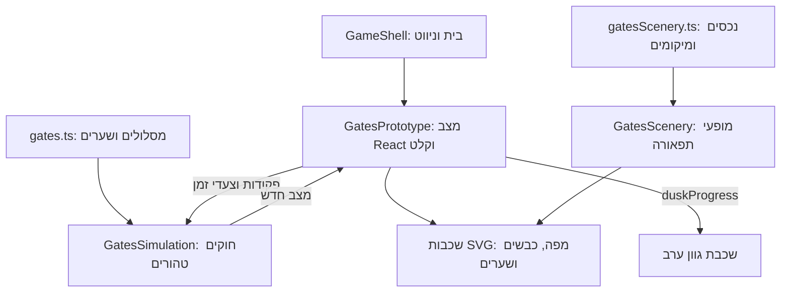
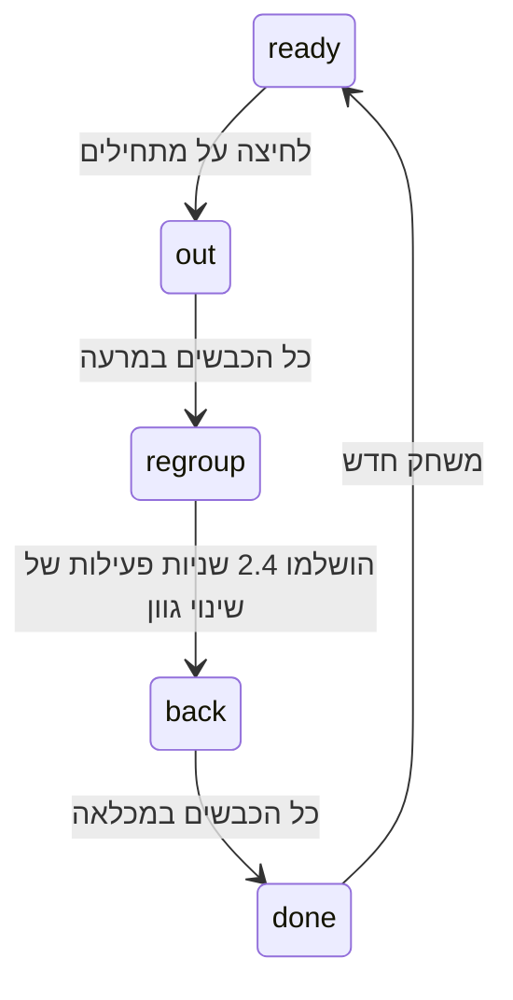

# שומרי השערים — ארכיטקטורה

> עדכון 13 בנובמבר 2026: נבנו חמישה שלבים, מעבדת כוונון, אנימציות ושמירה מקומית נפרדת. המסמך להלן מתעד את מצב אב־הטיפוס הקודם ואת התכנון הרחב. המצב העדכני מתועד ב־[תוכנית הליטוש ורישום הביצוע](gates-polish.md) וב־[ארכיטקטורת היישום](architecture.md#gatekeepers-five-level-standalone-game).

עודכן ב־12 בנובמבר 2026 לפי [תיאור המשחקון המעודכן](minigame-five.he.md). אב־הטיפוס של השלב הראשון ממומש ומשולב בבית. מסמך זה מתאר תחילה את הקוד הקיים, ולאחר מכן את התכנון שטרם מומש. [החלטות המפה](minigame-five-map.he.md) מתעדות את השינויים, ו[תוכנית ההמשך](minigame-five-build-plan.he.md) מפרטת את העבודה שנותרה.

## שילוב ובעלות על המצב

`GameShell.tsx` מציג מסך `gates` וכניסה לשומרי השערים בשורת בחירת המשחקונים בבית. הוא ממשיך לנהל ניווט והעדפות משותפות. המשחקון לא נוסף למערך `stages` ב־`src/content/chapter.ts`, לטיפוס `Mode` או לרשומות `Attempt` של משימות המילים. אין שינוי בסיום הפרק, ביתרת הפרסים או בהמלצות הקושי.

`GatesPrototype.tsx` מחזיק מצב React מקומי ומעביר פקודות וצעדי זמן לפונקציות טהורות. הציור הנוכחי הוא SVG בתוך React; אין במשחקון סצנת Phaser או גשר חזותי פעיל. זהו מצב אב־הטיפוס הקיים. הפרדת React כבעלים של החוקים ו־Phaser כבעלים של הציור נשארת יעד השילוב העתידי, ולא תיאור של קוד שכבר קיים.

## הקבצים הקיימים

| קובץ או תיקייה | אחריות בפועל |
| --- | --- |
| `src/content/gates.ts` | עקומות המסלול המשותף ושני ענפי המרעה, גישות חסומות, מיקומי שערים, מקשים, דגימת אורכים ומיקום כבשה לפי מרחק |
| `src/content/gatesScenery.ts` | קטלוג נכסי תפאורה, גבולות SVG ורשימת `stageOneScenery` עם מזהים וטרנספורמציות לכל מופע |
| `src/typing/GatesSimulation.ts` | טיפוסי `Game`, `Gate`, `Sheep`; הפונקציות `initial`, `operateGate`, `tick`; תנועה, תורים, מנוף, ניקוד ומעבר ערב אוטומטי |
| `src/app/gates/GatesPrototype.tsx` | בעלות על מצב הריצה, RAF, קלט פיזי, הפסקה, הוראות, מקלדת מסך, ציור העולם וסיכום |
| `src/app/gates/GatesScenery.tsx` | שכבת תפאורה עם קבוצה נפרדת לכל מופע, ללא חוקים או מצב למידה |
| `public/assets/gates/farm-background.svg` | קרקע, שני שטחי מרעה, שבילים ומכלאה ריקה בגודל לוגי 1600×900 |
| `public/assets/gates/scenery/` | עשרה נכסי SVG שקופים ועצמאיים של חפצי תפאורה |
| `public/assets/gates/` | בנוסף לרקע: כבשה, שער סגור, שער פתוח ושלט ריק; אותיות ומנעולים מצוירים בשכבת התצוגה |
| `tests/unit/gates.test.ts` | גאומטריה, חוקים, מסלול הלוך וחזור, מעבר ערב ותקינות נכסים עצמאיים |
| `tests/browser/gates.spec.ts` | קלט, טעינת תפאורה, חסימות, חזרה אוטומטית, הפסקה, ניקוי, שגיאות ופריסה |

מיקום החוקים ב־`src/typing` שומר על מוסכמת הפרויקט לחוקים טהורים. אין שימוש בחישוב שגיאות עריכה או תגמול על מילים. לא נוספה ספרייה ולא שונה ה־lockfile.

## מפת השלב והגאומטריה

המכלאה תופסת בקירוב `x=650..950, y=340..560`. יש ארבע גישות אליה ושני שטחי מרעה בשולי המפה. הגישה הדרומית מתחברת למסלול משותף של חמש עקומות Bézier קוביות. ארבעת שערי האותיות נמצאים בסופי ארבע העקומות הראשונות; לאחר העקומה החמישית מתפצל המסלול לשני ענפי מרעה, עם יעדים `(160,510)` ו־`(1440,510)`.

`gateControls` מגדיר ע/`KeyG`, י/`KeyH`, ח/`KeyJ`, ל/`KeyK` לפי סדר היציאה. `lockedGates` מגדיר חמישה מיקומי מנעול ללא פקודות: שלוש גישות למכלאה ושני מעקפים. `shortcutPaths` מתאר את שבילי הגישה החסומים. הכבשים אינן מנותבות דרך שערים נעולים.

השבילים אכן מצטלבים בתמונה, אך הצטלבות אינה צומת שמחליט מסלול בזמן ריצה. לכל כבשה ענף מרעה מוגדר; לפני הפיצול כל הכבשים חולקות מסלול וארבעה שערים. הרחבת מפה מחייבת כתיבה עקבית של המסלול ושל החסימות, ולא רק ציור שביל חדש.

לכל עקומה מחושבות 80 דגימות לצבירת אורך מקורב. `progress` הוא מרחק ביחידות העולם לאורך המסלול, לא חלק יחסי מ־0 עד 1 ולא מיקום במסך. `sheepPosition` מבצע אינטרפולציה בין הדגימות; ערכים שליליים ממקמים את הכבשים בתוך המכלאה. `gateDistances` מכיל את מרחקי השערים ו־`sharedDistance` את גבול המסלול המשותף. הטקסטים של נתיבי ה־SVG בתמונת הבסיס תואמים להגדרות התוכן, ובדיקת יחידה מגינה על ההתאמה. שינוי מסלול מחייב עדכון שני המקורות עד שיצירת הרקע תהיה משותפת אוטומטית.

## מצב הריצה והמעבר לערב

| שדה ב־`Game` | משמעות |
| --- | --- |
| `phase` | `ready`, `out`, `regroup`, `back`, `done` |
| `sheep` | מזהה, ענף מרעה (`lane`) ומרחק (`progress`) לכל כבשה |
| `gates` | מצב פתוח/סגור ומועד סגירה בזמן המשחק |
| `lever` | שער יעד, פעולת פתיחה/סגירה וזמן שנותר, או `null` |
| `duskProgress` | התקדמות רציפה של גוון הערב בטווח 0–1 |
| `time`, `waiting`, `score`, `commands` | זמן תנועה, שניות־כבשה מצטברות, ניקוד נגזר ומספר פקודות שהתקבלו |

הזרימה הנוכחית היא:

בכניסה ל־`regroup` כל השערים נסגרים והמנוף מתאפס. `tick` מקדם רק את `duskProgress` בקצב `dt / 2.4`; הכבשים אינן זזות, זמן התנועה אינו מתקדם וההמתנה והניקוד אינם משתנים. בהגעה ל־1 המנוע מחליף ל־`back` אוטומטית. אין חלון או אישור חזרה. `initial()` מאפס את הגוון ליום.

הגוון מצויר כמלבן גרדיאנט מעל כל שכבות העולם, מסגול כהה בחלק העליון לחום־כתום בתחתית, עם אטימות `duskProgress × 0.32`. פקדי HTML ושורת המקשים אינם נצבעים. ההוראה מעל המפה מתחלפת לסדר השערים בחזרה. הפסקה עוצרת גם את המעבר; אין אנימציית CSS או שעון עצמאי שממשיכים מאחורי ההפסקה.

## תנועה, תורים, שערים וניקוד

`initial()` יוצר ארבע כבשים, שתיים לכל ענף, וארבעה שערים סגורים. ערכי ההתחלה הם מהירות 105 יחידות עולם לשנייה, מרווח 64 ועצירה 40 יחידות לפני שער בכיוון ההתקדמות. אלה ערכי אב־טיפוס לכיול.

בכל צעד הכבשים מסודרות מהראש לאחור לפי כיוון ההליכה. היעד מוגבל על ידי המרעה או המכלאה, שער סגור והכבשה שלפניה. התור משותף לפני הפיצול ונפרד בענפים, עם שמירת מרווח באזור ההתחברות בחזרה. סדר השערים נובע מהמרחק ומהכיוון; אין מכונת קוד נוספת שבודקת רצף אותיות ברמת השלב.

`operateGate` מקבל רק אינדקס של שער פעיל ורק ב־`out` או `back`. מנוף עסוק דוחה פקודה ללא תור. הפקודה מחזיקה יעד ופעולה ל־0.8 שניות; בסיום המחזור משתנה `open`. פתיחה מתחילה חלון חמש שניות, ומעבר כבשה בנקודת השער מחדש אותו. סגירה אוטומטית אינה תופסת מנוף. השערים הנעולים נמצאים בתוכן ובציור בלבד ואינם נכללים במערך השערים הניתנים להפעלה.

המתנה עקב שער מתפשטת לתור; `waiting` שומר שברי שנייה והניקוד נגזר כ־`max(0, 1000 − floor(waiting))`. אין ניקוד עצמאי בשכבת הציור, ואין שינוי ביתרת החנות או במדדי המילים.

המנוע הנוכחי משתמש בחציית נקודת מרחק, לא באזור תפוס של כבשה. אין בו `closingPending`, שחרור גלים מתוזמן, חלוקת צעד לפי גבולות אירועים או הבטחת שקילות מלאה בין כל חלוקות הזמן. אלה הרחבות מתוכננות; אין לייחס אותן לאב־הטיפוס.

## קלט, שעון ומחזור חיים

אזור המשחק הוא HTML בר־מיקוד עם מאזין React מקומי. `KeyboardEvent.code` בוחר את השער; repeat, composition וקיצורי Ctrl/Alt/Meta מסוננים. שורת הבית נלקחת מ־`KeyboardMap.ts` ומשמרת את הסדר הפיזי משמאל לימין. מקש מסך מפעיל את אותה פונקציית פקודה ומחזיר מיקוד למשחק במחשב. אין הקלקה ישירה על שער ואין לכידת מקלדת גלובלית.

`requestAnimationFrame` פעיל ב־`out`, `regroup` ו־`back`. הבקר מעביר הפרש זמן בשניות, מוגבל ל־0.05 לכל מסגרת. זהו צעד משתנה מוגבל, ולא המימוש העתידי של צובר בצעדים קבועים של 20 מילישניות. מצב `paused` עוצר את RAF; הסתרת לשונית או אובדן מיקוד מפעילים הפסקה וחידוש דורש לחיצה. נקודת הזמן האחרונה מתאפסת בעצירה ובניקוי, כך שזמן הרקע אינו מושלם בדיעבד.

פירוק הרכיב מבטל RAF ומסיר מאזיני `visibilitychange` ו־`blur`. משחק חדש מחליף את המצב בתוצאת `initial()`. כל מצב הריצה הוא מקומי לרכיב ואינו נכתב ל־localStorage. יציאה או רענון מאבדים את ריצת השערים; השמירה הקיימת של משחקוני המילים אינה משתנה.

## חפצי תפאורה ושכבות ציור

`sceneryAssets` מגדיר קובץ ו־viewBox מקומי לכל אחד מעשרת הסוגים: `rock`, `bush`, `flower`, `grassTuft`, `dog`, `tree`, `barn`, `silo`, `hayBale`, `fence`. כל SVG מכיל את ההגדרות הדרושות לו, כולל גרדיאנטים וסמלים; אין הפניות להגדרות ברקע או בקובץ אחר.

`SceneryPlacement` כולל `id`, `asset`, `x`, `y`, ו־`rotation`/`scale` אופציונליים. `stageOneScenery` מכיל 21 מופעים במיקומים המקוריים. סדר הרשימה הוא סדר הציור. לשלב אחר אפשר לספק רשימת מופעים אחרת ל־`GatesScenery` בלי לשנות את קובצי הנכסים או את המנוע.

`GatesScenery` הוא רכיב ממוטב באמצעות `memo`. לכל מופע קבוצה עם `data-scenery-id` ו־`data-scenery-asset`; הקבוצה מחזיקה את טרנספורמציית המיקום, הסיבוב והגודל. אפשר להניע בעתיד את התמונה הפנימית בנפרד בלי לדרוס אותה. כרגע אין אנימציות תפאורה או שינויי מיקום אקראיים. שכבת התפאורה מוגבלת למלבן המפה 1600×900, כדי שנכס ליד שולי המפה לא יגלוש לשטח שמחוץ לה.

סדר השכבות: רקע בסיס → תפאורה → כבשים → שערי אותיות ושערים נעולים → גוון ערב → חלונות HTML לפי צורך. אין כפילות של החפצים בתוך תמונת הבסיס. הקרקע, המרעה, השבילים והמכלאה נשארים ברקע.

## פריסה ובדיקות קיימות

החווה שומרת על מערכת צירים 1600×900 ועל יחס ממדים ללא מתיחה. סרגל HTML ושורת המקשים מקבלים מקום לפני אזור המפה הגמיש. מסכי הילד נדרשים להתאים ל־1024×600, 1280×720 ו־1440×900 ללא גלילה, כולל הכנה, הפסקה, חידוש וסיום. יעד 1920×1080 כמינימום הוחלף בדרישות AGENTS.md. עיצוב המגע הקיים לרוחב הוא תוספת, ואינו בסיס להכרזה על אימות נייד מלא.

בדיקות היחידה מכסות התאמת עקומות לרקע, שני יעדי מרעה, עצירה בכל אחד מארבעת השערים בשני הכיוונים, מנוף משותף, סגירה ידנית ואוטומטית, ערב אוטומטי ללא חיוב המתנה ותקינות הפניות וגבולות נכסי התפאורה. בדיקות הדפדפן מכסות פריסה, טעינת כל סוג נכס ומופעים נפרדים, קלט פיזי, תורים, שינוי הגוון ללא אישור, עצירה באמצע המעבר, חזרה, משחק חדש וניקוי ללא שגיאות.

לשינויי קוד מריצים בדיקות לפי AGENTS.md, כולל בדיקות משחקוני המילים כדי להגן על הקלדה עברית, תיקון ושמירה קיימת. כל שרת בדיקות או אימות של הסוכן חייב להשתמש בפורט אחר מ־5173. יש להתאים יחד את כתובת הבסיס של Playwright ואת פורט השרת; אין להשתמש בשרת המשתמש או להפעילו מחדש לצורך בדיקות.

## הרחבות מתוכננות — אינן ממומשות

### תוכן ומנוע

נשארו בתכנון הדרכה, שלבים נוספים, מיפויים משתנים ורצפי שתי אותיות עם חלון ראשוני של 1.5 שניות, ולידציית קידומות וגלי יציאה וחזרה. מתווה 2/4/6/8 הישן אינו מתאר את השלב הראשון הנוכחי: הוא מתחיל בארבעה שערים משותפים. תצורות שאר השלבים מחייבות התאמה למפה החדשה; אין לקבע להן מספרים או מסלולים על סמך אב־הטיפוס בלבד.

תכנון המנוע המורחב כולל טיפוסים תחת `src/typing/gates/`, אזורי חצייה, `closingPending`, דחיית סגירה עד לפינוי פתח, צובר צעדים קבועים וחלוקה לפי זמני אירועים. הוא יידרש לשמור על מעבר הערב האוטומטי, השערים הנעולים, המסלול המשותף והפרדת התפאורה. שינוי איזון ילווה בגרסת תוכן וכללים כדי לא לשנות ריצות שמורות.

### Phaser וקול

העברה ל־`GatePhaserStage`, ‏`GateFarmScene` וגשר חזותי מטופס נשארה בתכנון. React ימשיך להחזיק את המצב והמנוע; Phaser יקבל צילום לקריאה בלבד, יעדכן אובייקטים לפי מזהים וינפיש ללא הכרעה על מעבר או ניקוד. לכידת המקלדת שלו תהיה כבויה. הנכסים הנפרדים ומזהי המופעים ישמשו גם שם. יש לנקות סצנות, tweens, מאזינים וגשר ב־StrictMode, בעצירה ובניווט, ולמנוע callback מריצה ישנה.

חיבור ייעודי של `AudioPlayer` למפתח ריצה ושלב טרם נוסף. בעת מימושו, מעבר יציאה/ערב/חזרה והפסקה לא יבחרו מנגינה חדשה ולא ייצרו נגן נוסף.

### שמירה, תוצאות ותאימות

ריצות השערים עדיין אינן נשמרות. התכנון הוא מודל משותף `version: 3` עם שדה `gates`, תוך שמירת מבנה `sessions` ומפתח `flock-and-key:game:v2`. הסבה מגרסה 2 תשמור את ההיסטוריה, הפרסים, ההעדפות והסשן הפעיל. אין לממש הסבה במסגרת עדכון תיעוד זה.

צילום עתידי יכלול תצורה וגרסאות, שלב תנועה ו־`duskProgress`, מרחקי כבשים וענפים, שערים וטיימרים, יעד מנוף וזמן נותר, גלים ומצבי חצייה אם יתווספו, המתנה וניקוד. שמירה מתוכננת לכל היותר פעם בשנייה ובאירועים משמעותיים, לא בכל פריים. שחזור יתחיל עצור, ללא זמן שחלף ברקע, וללא שינוי תוכן שקט בריצה ישנה.

ולידציה תבדוק טווחים, מזהים, תפוסת שער וקישורי מסלולים. נתון שערים פגום לא יאפס היסטוריית מילים תקינה; כשל כתיבה ישאיר משחק בזיכרון ואפשרות ייצוא. השלמה תהיה חד־פעמית לפי מזהה ניסיון. יתווספו מקטע הורה נפרד, JSON מלא ו־CSV שערים נפרד, עם תנאי השוואה זהים ובלי ערבוב במדדי איות והקלדת מילים. איפוס משותף ישמור העדפות קול וייכתב אטומית לפני החלפת המצב החי.
