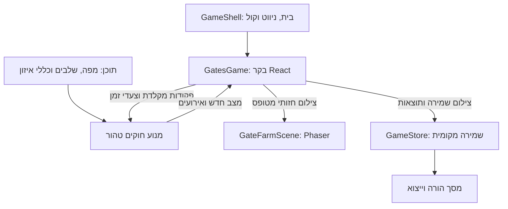

# שומרי השערים — ארכיטקטורה

12 בנובמבר 2026. ארכיטקטורה מיועדת למימוש, על בסיס [התכנון המאושר](minigame-five.he.md). הקבצים והטיפוסים החדשים המוזכרים כאן טרם נוצרו. סדר העבודה וקריטריוני הסיום נמצאים ב[תוכנית הבנייה](minigame-five-build-plan.he.md).

## שילוב במערכת הקיימת

המשחקון יקבל בקר React עצמאי ומנוע סימולציה טהור. `GameShell.tsx` יוסיף מסך `gates` וכניסה מהבית, וימשיך לנהל ניווט, העדפות קול והתקדמות משותפת. המשחקון לא יתווסף למערך `stages` שב־`src/content/chapter.ts` ולא לטיפוס `Mode` של משימות המילים.

ההפרדה חשובה משום שהקוד הנוכחי מניח ארבעה שלבי סיפור, משימות עם מילה צפויה ורשומות `Attempt`. שערים אינם משימת מילה. גם המלצות הקושי המבוססות על הצלחה ב־80% מהמילים לא יחולו כאן. התקדמות המשחקון תהיה הדרכה וארבעת השלבים שאושרו, ללא שינוי בפרק הקיים.

React הוא הבעלים של מצב המשחק. Phaser מצייר בלבד, ללא פיזיקה שמכריעה מעברים, שעוני משחק או לכידת מקלדת. כל שינוי חוקי עובר דרך מנוע הסימולציה.

## חלוקת קבצים

| קובץ או תיקייה מתוכננים | אחריות |
| --- | --- |
| `src/content/gates.ts` | ארבעה מסלולים, מיקומי שערים, מיפוי אותיות ורצפים תלוי־שלב, הדרכה, שלבים, לוחות שחרור וערכי איזון |
| `src/typing/gates/types.ts` | טיפוסי תוכן, מצב, פקודות, אירועים ותוצאות ללא תלות ב־React או Phaser |
| `src/typing/gates/geometry.ts` | מרחק לאורך מסלול, מיקום וכיוון ממנו, אזורי חצייה ומרווחים |
| `src/typing/gates/engine.ts` | יצירת שלב, צעדי סימולציה, תנועה, תורים, שערים, מנוף וניקוד |
| `src/typing/gates/selectors.ts` | חישוב תצוגה, סיכום, מצב המנוף ורצפי הקלדה והשוואת תוצאות תואמות |
| `src/app/gates/GatesGame.tsx` | הכנה, הדרכה, שלב פעיל, חזרה, עזרה וסיכום |
| `src/app/gates/useGateRuntime.ts` | שעון, קלט ממוקד, עצירה, ניקוי וחיבור צילום השמירה לבקר |
| `src/components/GatePhaserStage.tsx` | יצירת מופע Phaser, חיבור לגשר והתאמת גודל |
| `src/game/gatesBridge.ts` | טיפוסי צילום חזותי ופקודות ייעודיים |
| `src/game/scenes/GateFarmScene.ts` | ציור חווה ממבט על, כבשים, שערים ואפקטים |
| `src/progress/GateProgress.ts` | טיפוסי ריצות, ולידציה, סיכומים וייצוא CSV ייעודי |
| `src/progress/GameStore.ts` | שילוב בשמירה המשותפת, הסבת גרסה, איפוס וייצוא JSON מלא |

מיקום החוקים תחת `src/typing` שומר על מוסכמת הפרויקט לחוקים טהורים של תרגול. אין שימוש בחישוב שגיאות עריכה או תגמול על מילים עבור שערים. אין צורך בספרייה חדשה או בשינוי lockfile.

## תוכן וגרסאות

`GateLevelDefinition` יכיל מזהה שלב, גרסת תוכן וכללי איזון, הפניה למפה, שערים פעילים, קבוצות, זמני שחרור ביציאה ובחזרה, מהירות, מרווח בין כבשים ואורך אזור חצייה. מיפוי השערים לאות בודדת או לרצף מסודר של שתי אותיות מוגדר לכל שלב בנפרד; שערים נשארים באותם מיקומים והתוויות תמיד גלויות.

המסלולים יהיו קווים שבורים מעוקלים למראית עין במערכת צירים לוגית אחת. ציור השביל ומיקום הכבשים יחושבו מאותם מקטעים ואורכים. הסימולציה משתמשת במרחק לאורך שביל, לא בפיקסלים של המסך. היציאה מגדילה את המרחק והחזרה מקטינה אותו. שער מוגדר באמצעות מרחק על אותו מסלול, עם גבולות כניסה ויציאה לאזור החצייה בשני הכיוונים.

ולידציית תוכן תבדוק מזהים ופקודות חד־משמעיות (ללא מיפוי זהה לשני שערים, או התנגשות קידומת בין אות יחידה לרצף), התאמה ל־`KeyboardMap.ts`, גבולות מפה, שערים על השביל, מרחק בין שערים, לוחות שחרור תקינים ויעדים עם מקום לכל הקבוצה. גרסה ראשונה: הדרכה עם שער אחד, ואחריה 2, 4, 6 ו־8 שערים. ערכי התחלה: מחזור מנוף משותף של 0.8 שניות, פקיעת רצף חלקי אחרי 1.5 שניות, סגירה מקומית לאחר 5 שניות ללא חצייה, ניקוד התחלתי 1,000 וקנס של נקודה לשניית המתנה של כבשה. זמני המנוף והרצף מיועדים לכיול.

ריצה שומרת צילום של התצורה ששימשה אותה, כולל גרסאות. שינוי איזון עתידי לא משנה ריצה שמורה. אם גרסת המנוע אינה יכולה לחדש צילום ישן, מציגים הודעה ואפשרות להתחיל מחדש, ושומרים את ההיסטוריה לייצוא. לא מחדשים לפי תוכן חדש באופן שקט.

## מודל המצב

| מודל | שדות עיקריים |
| --- | --- |
| `GateRun` | מזהה, תאריכי התחלה וסיום, סטטוס, שלב נוכחי, תצורות הריצה, ניסיונות שלבים |
| `GateStageState` | מזהה ניסיון, שלב תנועה, מספר צעד, זמן פעיל, שערים, כבשים, לוח גלים, מצב המנוף ומדדים |
| `GateState` | מזהה, מצב `closed/open/closingPending`, מועד סגירה בזמן הסימולציה, מזהה כבשה חוצה אם יש |
| `SheepState` | מזהה, קבוצה, שביל, מרחק, יעד ומצב `scheduled/moving/waiting/crossing/pasture/home` |
| `GateStageResult` | מזהה ניסיון, תצורה וגרסאות, השלמה או דילוג, ניקוד, זמן פעיל, המתנה, פתיחות, פקודות שנדחו בשל מנוף עסוק ושימוש בעזרה |

מצב שלב התנועה הוא `outbound → regroup → inbound → complete`. `regroup` ממתין לאישור ״מחזירים הביתה״ לפני גל החזרה; אין בו זמן סימולציה או ירידת ניקוד. זמני גל החזרה יחסיים לכניסה ל־`inbound`. קבוצה שכבר במרעה ממתינה שם בלי חיוב בזמן שקבוצות אחרות עדיין יוצאות.

מצבי הממשק הם הכנה, הדרכה, משחק, עזרה, הפסקה, חזרה משמירה וסיכום. הם נפרדים משלב התנועה. עצירה אינה מחליפה `outbound` בסטטוס אחר ואינה מוחקת אותו. סט סיבות עצירה, כגון עזרה, אובדן מיקוד ורענון, מונע מביטול סיבה אחת לחדש משחק שעדיין חייב להיות עצור. חידוש תמיד דורש פעולה מפורשת.

הניקוד נגזר מיתרת ההמתנה המצטברת ואינו מונה נוסף שיכול לסטות ממנה. נשמרים ערכים לא מעוגלים; התצוגה בלבד מתעגלת. יתרת החנות, `earned`, מדדי מילים והמלצות קושי אינם משתנים במשחקון.

## שעון, פקודות וסדר חישוב

ממשק המנוע המתוכנן הוא `createStage(definition)`, ‏`reduceCommand(state, command)` ו־`advance(state, stepMs)`. התוצאה כוללת מצב חדש ואירועים מטופסים למשוב. הפונקציות אינן קוראות שעון דפדפן, יוצרות מזהים אקראיים או מפעילות אפקטים. מזהי ניסיון נוצרים בבקר ונמסרים למנוע.

הבקר ישתמש ב־`requestAnimationFrame` ובצעדים קבועים של 20 מילישניות, עם צובר שארית. הפקודות מעובדות בסדר הגעתן לפני הצעד הבא. מנוף וטיימרים מחושבים לפי זמן הסימולציה בלבד, לא באמצעות `setTimeout` לכל שער.

פער מסגרת חריג מעל 250 מילישניות יעביר להפסקה עם אפשרות חידוש; לא מריצים את כל הזמן החסר כקפיצה. בעצירה ובחידוש מאפסים את נקודת המדידה ואת שארית הצובר. כך לשונית שהוסתרה אינה מקדמת מחזור מנוף, תורים או הפחתת ניקוד בדיעבד. זמני הצגה ותאריכי היסטוריה נשמרים בנפרד מזמן המשחק הפעיל.

בתוך צעד, זמן ההגעה לשער, תום החצייה, פקיעת הטיימר, השלמת מחזור מנוף ושחרור קבוצה הם גבולות אירועים. המנוע מחלק את הצעד בגבולות אלה ומחשב זמני מנוף והמתנה לכל תת־קטע. כך כבשה שנעצרה באמצע הצעד אינה מחויבת כאילו המתינה בכולו. במקרה של שוויון זמנים: מסיימים חצייה, מבצעים סגירה ידנית ממתינה, בודקים סגירה אוטומטית, ואז מאפשרים כניסה חדשה. חצייה שהושלמה מאפסת טיימר אוטומטי; בקשת סגירה ידנית נשארת בתוקף.

כל צעד מעדכן תנועה, חסימות, המתנה, מנוף ומעבר בין שלבי התנועה באופן דטרמיניסטי. אין תלות בזמן שהציור ב־Phaser סיים tween. בדיקות יכסו גם חלוקות שונות של אותו זמן מסגרות.

## תורים, חצייה ושערים

בכל שביל מסדרים כבשים לפי כיוון התנועה ומעדכנים מהראש לאחור. כל כבשה מוגבלת על ידי היעד, השער הבא ומרחק בטוח מהכבשה שלפניה. אין תנועת נגד באותו גל. גבולות המרעה והמכלאה מספקים מקום לקבוצה, כך שכבשה שהגיעה ליעד אינה חוסמת את השביל.

בכל שער יכולה לחצות כבשה אחת בכל רגע. כבשה נכנסת לאזור חצייה רק כשהשער פתוח ואינו ממתין לסגירה. היא משחררת אותו רק אחרי שכולה יצאה ממנו. בקשת סגירה במעבר מעבירה ל־`closingPending`, עוצרת כניסות חדשות ומבוצעת כשהאזור פנוי. לחיצות נוספות בזמן `closingPending` לא מבטלות את הסגירה ואינן מפעילות מנוף; פתיחה חדשה תתאפשר לאחר סגירה בפועל.

פקודה לשער קיים מתקבלת רק כשהמנוף פנוי. היא תופסת אותו למחזור הפעולה, ושינוי השער מתרחש בסיומו. פקודות נוספות במהלך המחזור נדחות ללא תור. פעולת פתיחה מתחילה טיימר של חמש שניות עם השלמתה; כל חצייה מחדשת אותו. סגירה אוטומטית מקומית אינה תופסת את המנוף. מצב מנוף כולל יעד, פעולה, זמן נותר ומזהה פקודה לצורך שחזור מדויק.

סיבת ההמתנה מתפשטת לאחור לאורך התור: שער סגור או `closingPending` שחוסם כבשה גורם גם לממתינות מאחוריה להיחשב ממתינות. מרווח טבעי בין כבשים וחצייה בשער פתוח אינם המתנה חייבת. פתיחת השער מבטלת את סיבת החיוב של התור מיד, גם לפני שכולו יצא לדרך. כל כבשה משויכת לכל היותר לחסימה אחת בכל רגע.

## קלט וממשק React

אזור המשחק הוא רכיב HTML בר־מיקוד עם שם והוראות נגישים. מאזין React מקומי מקבל `KeyboardEvent.code` ומפרש אות יחידה או רצף מסודר בן שתי אותיות לפי מיפוי השלב. מצב רצף חלקי מוצג ליד השער, פג לאחר 1.5 שניות משחק פעיל, ומתאפס בעצירה ובאובדן מיקוד. מיפויים חייבים להיות חד־משמעיים. הוא מתעלם מ־repeat, ‏composition, קיצורים עם Ctrl/Alt/Meta ומטרות עריכה. ברענון, עצירה וניווט מתנקה רישום המקשים המוחזקים; אחרי חידוש נדרשת לחיצה חדשה. מיפוי המקשים משתמש במקור הקיים `KeyboardMap.ts`.

סרגל HTML מציג ניקוד, מצב מנוף משותף ושלב; כפתורי עזרה, הפסקה, חידוש ודילוג נשארים ב־React. העזרה משתמשת במקלדת החזותית הקיימת ככל שהממשק שלה מאפשר זאת. אין שדה מילים מלאכותי ואין מדידת הקלדה סמויה. עדכוני מצב נגישים יהיו קצרים ובהתרחשויות משמעותיות, ללא הכרזת ניקוד בכל צעד.

רכיב המשחק יחזיק את המצב החי באמצעות reducer מקומי. העדכונים המהירים לא יכתבו את כל היסטוריית המשחק ל־localStorage בכל פריים. `GameShell` יקבל צילומי שמירה תקופתיים ואירועים חשובים, ולא יריץ עותק של הסימולציה.

## ציור, גשר ומחזור חיים

גשר נפרד מה־`world/celebrate` הקיים יקבל `snapshot` עם מזהה ניסיון, מספר צעד, מפה, מיקומי כבשים ומצבי שערים, ופקודות אפקט עם מזהה אירוע. סצנה שמתחברת מקבלת מיד צילום מלא, גם אם התחברה אחרי שהבקר כבר נוצר. צילום חזותי הוא פלט לקריאה בלבד; אין בו חוקים או יתרת ניקוד עצמאית.

הסצנה תשמור אובייקטים חזותיים לפי מזהים ותעדכן אותם במקום לצייר מחדש את כל העולם בכל צעד. אינטרפולציה יכולה להחליק תנועה בין צילומים; היא אינה מאפשרת לכבשה להמשיך מעבר למצב האחרון הידוע. חידוש, טעינת שלב ועצירה מאפסים תנועה חזותית ישנה. אנימציה אינה שולחת ״הכבשה עברה״ בחזרה למנוע.

`GatePhaserStage` יפעיל `input: { keyboard: false }`. ההרכבה והניקוי יתמכו ב־React StrictMode: ביטול RAF, ניתוק מאזינים, איפוס הגשר, השמדת מופע Phaser וכל האנימציות. callbacks ייבדקו מול מזהה הניסיון הנוכחי כדי שאירוע מריצה קודמת לא ישנה ריצה חדשה.

מוזיקה תשתמש ב־`AudioPlayer` הקיים עם מפתח של ריצה ושלב. מעבר יציאה/חזרה, עזרה וחידוש אינם מחליפים מנגינה. הבקר מדווח את עצירתו לשכבת הקול; לא יוצרים נגן רקע שני.

## שמירה ותאימות

ההתקדמות המשותפת תעבור ל־`version: 3` עם שדה `gates` הכולל ריצות ומזהה ריצה פעילה. מבנה `sessions` של ארבעת המשחקונים נשמר. מפתח ה־localStorage הקיים `flock-and-key:game:v2` יישאר יציב; הסיומת ההיסטורית אינה גרסת מבנה הנתונים שבתוכו. הדבר מאפשר כתיבה אטומית של כל ההתקדמות ושל איפוס בלי תיאום בין שני מפתחות.

הטוען יזהה גרסה 2, יבצע את הוולידציה הקיימת וייצור גרסה 3 עם התקדמות שערים ריקה. נתוני מילים, סשן פעיל, פרסים, העדפות והמלצות נשמרים. ההסבה תיכתב רק אחרי הצלחת הוולידציה; כשל כתיבה משאיר את המידע הישן באחסון ואת החדש בזיכרון עם אזהרה. זו הסבה קדימה; תאימות לפתיחה בגרסת קוד ישנה אינה יעד.

הוולידציה החדשה תבדוק ערכים סופיים ובטווח, קישורים בין מזהים, מיקומים חוקיים, תפוסת שער יחידה, לוחות גלים ומצבי חצייה וסגירה. ריצת שערים פגומה תסומן כבלתי ניתנת לחידוש, עם אזהרה ושמירת הנתון הגולמי לייצוא; אין לאפס בגללה היסטוריית מילים תקינה. גם השדה המבודד יוגבל בגודל כדי למנוע טעינה לא מוגבלת של תוכן פגום.

צילום מלא ועקבי יישמר לכל היותר פעם בשנייה בזמן משחק, ומיד בקבלת פקודת מנוף ובהשלמתה, שינוי גל, עזרה, עצירה, יציאה וסיום שלב. `visibilitychange` ו־`pagehide` ינסו לשמור צילום נוכחי. חזרה משמירה תמיד עצורה. קריסת דפדפן עשויה לאבד את השבריר האחרון מאז השמירה; לא מוצגת הבטחה לשמירה אחרי כל פריים.

בעת משחק המצב בבקר הוא המקור המוסמך; צילום ההתקדמות המשותף הוא נקודת שחזור בלבד. עצירה וניווט מעבירים את הצילום האחרון לפני פירוק הבקר. ריצה חדשה שומרת את הקודמת כחלקית. חזרה על שלב יוצרת מזהה ניסיון חדש ושומרת את התוצאה הקודמת. השלמת ניסיון נרשמת פעם אחת לפי המזהה שלו, גם אחרי רענון או לחיצות כפולות.

איפוס ההורה יכתוב בבת אחת מודל ריק לשני סוגי המשחקונים וישמר העדפות קול. אם הכתיבה נכשלת, המצב החי אינו מתאפס. JSON כולל את התקדמות השערים; יתווסף CSV נפרד עם שורה לניסיון שלב, כולל ניסיונות חלקיים. CSV המילים שומר את משמעותו הקיימת. במסך ההורה יוצג מקטע שערים נפרד, ללא הכללתו בדיוקים, בקצב או בהישגי איות.

## פריסה ונגישות

יעד התכנון הוא מחשב שולחני עם תצוגת 1920×1080 לפחות ומקלדת פיזית. ארבעת השבילים ושמונת השערים יופיעו בעולם לוגי קבוע. אזור החווה הוא קומפוזיציית landscape רחבה, לא אזור ריבועי מוכתב. מצלמת Phaser מנצלת את השטח הזמין ומאפשרת יותר שטח תצוגה במסכים גדולים בלי לעוות או למתוח את המפה. רכיבי מצב מנוף, ניקוד, הפסקה ועזרה מוצגים ב־HTML מחוץ לשטח הציור.

בדיקות הפריסה יתייחסו ל־1920×1080 כגודל מסך, ויבדקו גם אזור תוכן דפדפן קטן במעט בגלל ממשק הדפדפן. אין דרישה לגרסת מובייל או ל־1024×600. תוויות יחידות ורצפים נשארות קריאות בכל שמונת השערים. הכנה, עזרה וסיכום יכולים להחליף את אזור המפה כשהמשחק עצור; מצב השער אינו מזוהה באמצעות צבע בלבד, והמיקוד חוזר למקום ברור לאחר עזרה.

## בדיקות ומגבלות

Vitest יבדוק חוקים, גאומטריה, שחזור, הסבת שמירה ונתונים. Playwright יבדוק קלט פיזי, תנועה ושערים, עצירה, עזרה, רענון, ניווט חוזר, ייצוא, שגיאות מסוף ופריסה. תרחישי בדיקה יפעילו את אותם חוקים ותוכן של המשחק, לרבות רצפי מקשים, דחיית פקודות בזמן מנוף עסוק ושחזור מנוף באמצע פעולה.

לפני הוספת כל שלב מתקדם יורץ תרחיש פתיחות מתוכנן כדי לבדוק שניתן להשלים אותו ושמחזורי המנוף מאפשרים זרימה סבירה. בדיקה אוטומטית אינה מוכיחה שהמפה קריאה או שהמשחק מהנה; נדרשת גם התנסות במקלדת העברית הפיזית. יעדי דקה עד שתיים לשלב וערכי האיזון יכוילו בהמשך, תוך שמירת גרסאות להשוואות.
